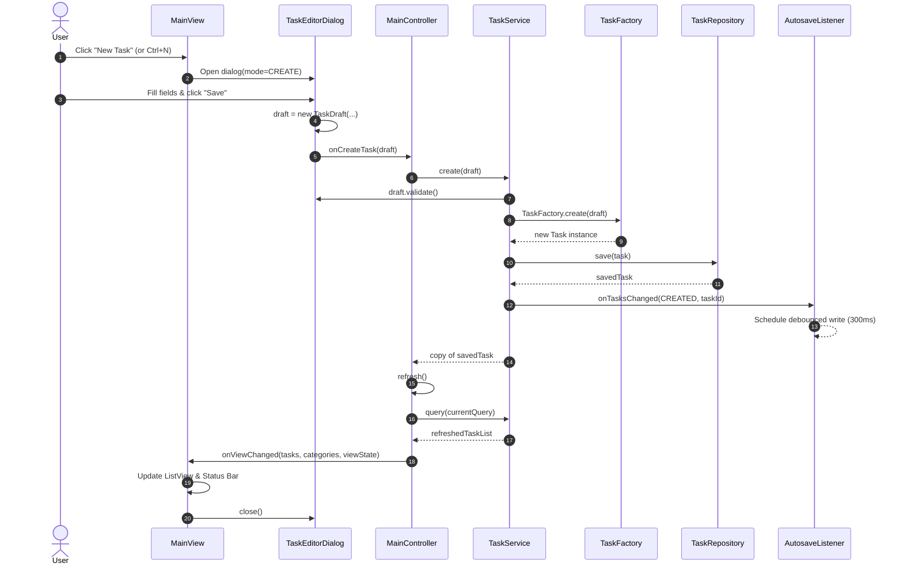
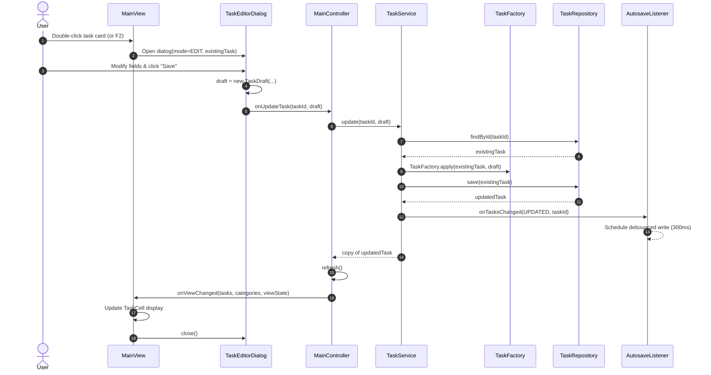
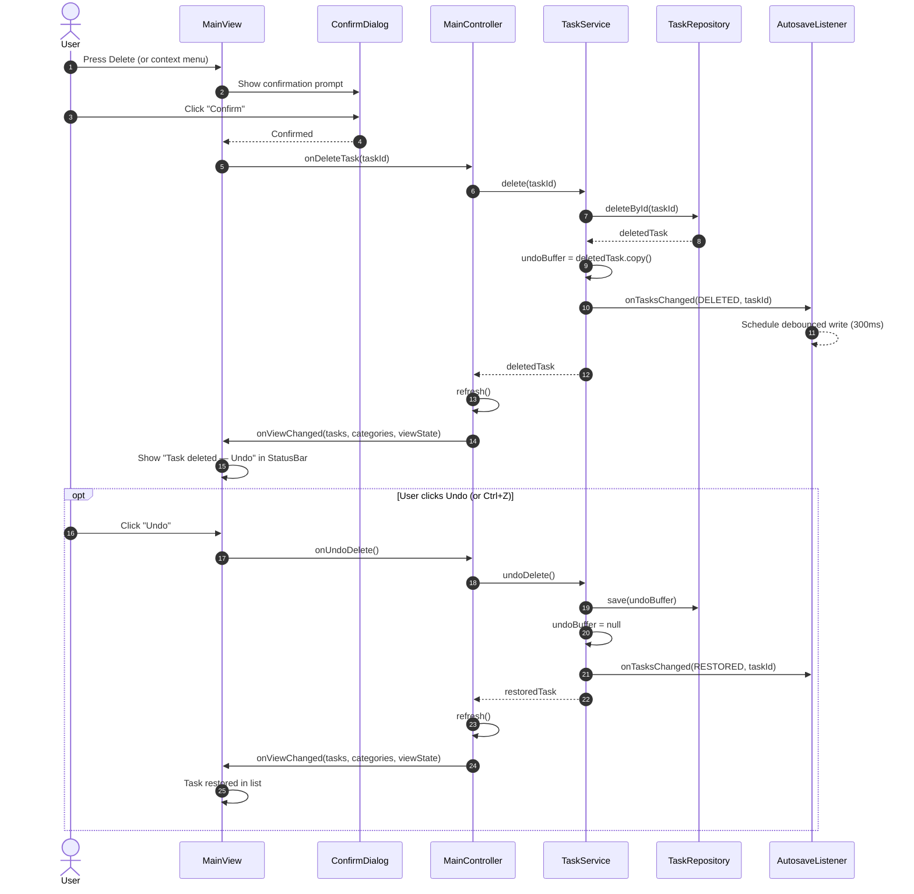
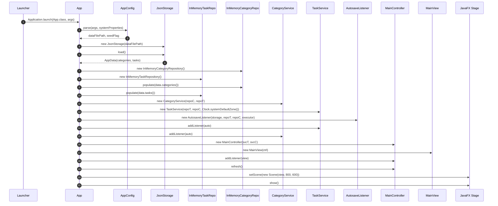
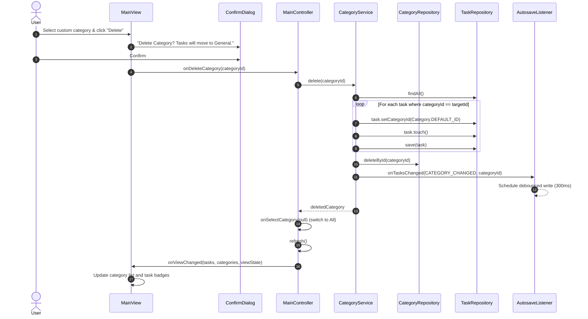
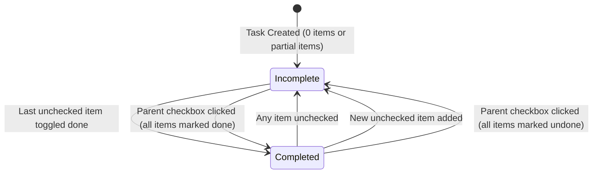

# Software Architecture & Detailed Design Document
## TODO List Desktop Application

> **Project:** Simple TODO list desktop application (Google Keep / Microsoft Notes style) in Java 17 and JavaFX 21.  
> **Course / Context:** Software Construction — Lab Open-Ended Lab (OEL)  
> **Assignment Task Mapping:** Task 2 (Plan/design architecture, classes, methods, data structures) · **CLO:** CLO 2.

---

## 1. Architecture Overview

The system follows a strict layered architecture with unidirectional dependencies pointing downward. Business rules, data access, and persistence are decoupled completely from the UI toolkit. Nothing outside `ui`, `App`, and `Launcher` imports `javafx.*`.

```
┌─────────────────────────────────────────────────────────────┐
│  ui (JavaFX views, dialogs, custom cells, CSS styling)      │  ← Pure presentation
└──────────────────────────────┬──────────────────────────────┘
                               │ calls / listens
┌──────────────────────────────▼──────────────────────────────┐
│  controller (MainController, ViewState, ViewListener)       │  ← Translates UI actions to service calls
└──────────────────────────────┬──────────────────────────────┘
                               │ calls
┌──────────────────────────────▼──────────────────────────────┐
│  service (TaskService, CategoryService, TaskQuery)          │  ← Business logic, validation, events
└──────────────────────────────┬──────────────────────────────┘
                               │ queries / updates
┌──────────────────────────────▼──────────────────────────────┐
│  repository (TaskRepository, CategoryRepository)            │  ← Storage-agnostic data access abstractions
└──────────────────────────────┬──────────────────────────────┘
                               │ loaded by / saved by
┌──────────────────────────────▼──────────────────────────────┐
│  storage (Storage, JsonStorage, JsonMapper, Autosave)       │  ← Atomic file I/O, JSON mapping
└──────────────────────────────┬──────────────────────────────┘
                               │ operates on
┌──────────────────────────────▼──────────────────────────────┐
│  model (Task hierarchy, Category, enums, TaskDraft)         │  ← Core domain types (used across all layers)
└─────────────────────────────────────────────────────────────┘
```

### 1.1 Architectural Invariants
1. **Zero UI Coupling in Core:** The `model`, `repository`, `service`, `storage`, and `controller` packages must not import any `javafx.*` types. This ensures 100% testability in standard, fast JUnit test runners without headless harness overhead.
2. **Immutability & Encapsulation Boundary:** The `TaskService` returns deep copies of `Task` objects to callers via `Task.copy()`. External consumers (such as UI controllers) cannot mutate stored entity state directly; mutations must go through explicit service calls using immutable `TaskDraft` records.
3. **Downward Dependencies Only:** A layer may only reference layers below it or the shared `model` layer. Inverted communication is handled strictly via interfaces (`TaskChangeListener`, `ViewListener`).
4. **Thread Isolation:** All scene-graph manipulations execute strictly on the JavaFX Application Thread. Disk I/O (persistence, autosave debouncing) runs asynchronously off-thread, reporting back to the UI via `Platform.runLater`.

---

## 2. Package Structure

```
todo-app/
├── pom.xml
├── README.md
├── implementation.md
├── .gitignore
├── docs/
│   ├── requirements.md      (M01)
│   ├── design.md            (M02, detailed design)
│   ├── test-plan.md         (M12)
│   ├── user-guide.md        (M13)
│   ├── course-mapping.md    (M13)
│   └── report.md            (M14)
└── src/
    ├── main/java/com/todoapp/
    │   ├── Launcher.java    (Plain main class launching JavaFX application)
    │   ├── App.java         (JavaFX Application entry point)
    │   ├── AppConfig.java   (Command-line & system properties parser)
    │   ├── model/           (Task, SimpleTask, ChecklistTask, ChecklistItem, DeadlineTask,
    │   │                     Category, Priority, TaskType, TaskDraft, TaskFactory)
    │   ├── repository/      (TaskRepository, CategoryRepository,
    │   │                     InMemoryTaskRepository, InMemoryCategoryRepository)
    │   ├── service/         (TaskService, CategoryService, TaskQuery, SortOption, StatusFilter,
    │   │                     TaskChangeListener, ChangeType, ValidationException, NotFoundException)
    │   ├── storage/         (Storage, JsonStorage, AppData, JsonMapper, AutosaveListener, StorageException)
    │   ├── controller/      (MainController, ViewState, ViewListener)
    │   └── ui/              (MainView, ToolbarPane, CategoryPane, TaskListPane, TaskCell,
    │                         TaskEditorDialog, CategoryDialog, StatusBar, Theme)
    ├── main/resources/com/todoapp/ui/styles.css
    └── test/java/com/todoapp/
```

---

## 3. Comprehensive Class Design

The class diagram below depicts all core interfaces, domain entities, repositories, services, persistence mappers, controllers, and primary UI components along with their key public method signatures.

```mermaid
classDiagram
    direction TB

    %% Model Layer
    class Task {
        <<abstract>>
        -UUID id
        -String title
        -String description
        -Priority priority
        -UUID categoryId
        -boolean completed
        -boolean pinned
        -LocalDateTime createdAt
        -LocalDateTime updatedAt
        +getId() UUID
        +getTitle() String
        +setTitle(String)
        +getDescription() String
        +setDescription(String)
        +getPriority() Priority
        +setPriority(Priority)
        +getCategoryId() UUID
        +setCategoryId(UUID)
        +isCompleted() boolean
        +setCompleted(boolean)
        +isPinned() boolean
        +setPinned(boolean)
        +getCreatedAt() LocalDateTime
        +getUpdatedAt() LocalDateTime
        +touch()
        +getType()* TaskType
        +getSummary()* String
        +getProgress()* double
        +getDueDate()* Optional~LocalDate~
        +isOverdue(LocalDate)* boolean
        +copy()* Task
    }

    class SimpleTask {
        +getType() TaskType
        +getSummary() String
        +getProgress() double
        +getDueDate() Optional~LocalDate~
        +isOverdue(LocalDate) boolean
        +copy() SimpleTask
    }

    class ChecklistTask {
        -List~ChecklistItem~ items
        +getItems() List~ChecklistItem~
        +addItem(String) ChecklistItem
        +removeItem(UUID) boolean
        +toggleItem(UUID) boolean
        +setCompleted(boolean)
        +getType() TaskType
        +getSummary() String
        +getProgress() double
        +getDueDate() Optional~LocalDate~
        +isOverdue(LocalDate) boolean
        +copy() ChecklistTask
    }

    class DeadlineTask {
        -LocalDate dueDate
        +getDueDateValue() LocalDate
        +setDueDate(LocalDate)
        +getType() TaskType
        +getSummary() String
        +getProgress() double
        +getDueDate() Optional~LocalDate~
        +isOverdue(LocalDate) boolean
        +copy() DeadlineTask
    }

    class ChecklistItem {
        -UUID id
        -String text
        -boolean done
        +getId() UUID
        +getText() String
        +setText(String)
        +isDone() boolean
        +setDone(boolean)
        +copy() ChecklistItem
    }

    class Category {
        -UUID id
        -String name
        -String colorHex
        +getId() UUID
        +getName() String
        +setName(String)
        +getColorHex() String
        +setColorHex(String)
        +static createDefault() Category
    }

    class Priority {
        <<enumeration>>
        HIGH
        MEDIUM
        LOW
        -int rank
        -String label
        +getRank() int
        +getLabel() String
        +static fromLabel(String) Priority
    }

    class TaskType {
        <<enumeration>>
        SIMPLE
        CHECKLIST
        DEADLINE
    }

    class TaskDraft {
        <<record>>
        +TaskType type
        +String title
        +String description
        +Priority priority
        +UUID categoryId
        +LocalDate dueDate
        +List~String~ checklistItems
        +validate()
    }

    class TaskFactory {
        +static create(TaskDraft) Task
        +static apply(Task, TaskDraft)
    }

    Task <|-- SimpleTask
    Task <|-- ChecklistTask
    Task <|-- DeadlineTask
    ChecklistTask "1" *-- "0..*" ChecklistItem
    Task --> Priority
    Task --> TaskType
    Task ..> Category : references categoryId
    TaskFactory ..> Task : creates/modifies
    TaskFactory ..> TaskDraft : consumes

    %% Repository Layer
    class TaskRepository {
        <<interface>>
        +findAll() List~Task~
        +findById(UUID) Optional~Task~
        +save(Task) Task
        +deleteById(UUID) Optional~Task~
        +clear()
        +count() int
    }

    class InMemoryTaskRepository {
        -Map~UUID, Task~ tasks
        +findAll() List~Task~
        +findById(UUID) Optional~Task~
        +save(Task) Task
        +deleteById(UUID) Optional~Task~
        +clear()
        +count() int
    }

    class CategoryRepository {
        <<interface>>
        +findAll() List~Category~
        +findById(UUID) Optional~Category~
        +findByNameIgnoreCase(String) Optional~Category~
        +save(Category) Category
        +deleteById(UUID) Optional~Category~
        +clear()
        +count() int
    }

    class InMemoryCategoryRepository {
        -Map~UUID, Category~ categories
        +findAll() List~Category~
        +findById(UUID) Optional~Category~
        +findByNameIgnoreCase(String) Optional~Category~
        +save(Category) Category
        +deleteById(UUID) Optional~Category~
        +clear()
        +count() int
    }

    TaskRepository <|.. InMemoryTaskRepository
    CategoryRepository <|.. InMemoryCategoryRepository

    %% Service Layer
    class TaskService {
        -TaskRepository taskRepo
        -CategoryRepository categoryRepo
        -Clock clock
        -List~TaskChangeListener~ listeners
        -Task undoBuffer
        +create(TaskDraft) Task
        +update(UUID, TaskDraft) Task
        +delete(UUID) Task
        +undoDelete() Optional~Task~
        +get(UUID) Task
        +getAll() List~Task~
        +toggleComplete(UUID) Task
        +setPriority(UUID, Priority) Task
        +togglePinned(UUID) Task
        +query(TaskQuery) List~Task~
        +countByPriority(TaskQuery) Map~Priority, Integer~
        +countActive() int
        +countCompleted() int
        +addListener(TaskChangeListener)
    }

    class CategoryService {
        -CategoryRepository categoryRepo
        -TaskRepository taskRepo
        -List~TaskChangeListener~ listeners
        +create(String, String) Category
        +rename(UUID, String) Category
        +recolor(UUID, String) Category
        +delete(UUID) Category
        +getAll() List~Category~
        +get(UUID) Category
        +countTasks(UUID) int
        +addListener(TaskChangeListener)
    }

    class TaskChangeListener {
        <<interface>>
        +onTasksChanged(ChangeType, UUID)
    }

    class TaskQuery {
        <<record>>
        +UUID categoryId
        +StatusFilter status
        +Priority priority
        +String searchText
        +SortOption sort
        +boolean ascending
        +withCategory(UUID) TaskQuery
        +withStatus(StatusFilter) TaskQuery
        +withPriority(Priority) TaskQuery
        +withSearch(String) TaskQuery
        +withSort(SortOption, boolean) TaskQuery
    }

    TaskService --> TaskRepository
    TaskService --> CategoryRepository
    TaskService ..> TaskChangeListener : notifies
    CategoryService --> CategoryRepository
    CategoryService --> TaskRepository
    CategoryService ..> TaskChangeListener : notifies
    TaskService ..> TaskQuery : filters with

    %% Storage Layer
    class Storage {
        <<interface>>
        +load() AppData
        +save(AppData)
    }

    class JsonStorage {
        -Path filePath
        -String lastLoadWarning
        +load() AppData
        +save(AppData)
        +getLastLoadWarning() Optional~String~
    }

    class AppData {
        <<record>>
        +int schemaVersion
        +List~Category~ categories
        +List~Task~ tasks
    }

    class JsonMapper {
        +static toJson(AppData) JsonObject
        +static fromJson(JsonObject) AppData
        +static taskToJson(Task) JsonObject
        +static taskFromJson(JsonObject) Task
    }

    class AutosaveListener {
        -Storage storage
        -TaskRepository taskRepo
        -CategoryRepository categoryRepo
        -ScheduledExecutorService executor
        -Consumer~String~ errorCallback
        +onTasksChanged(ChangeType, UUID)
        +flush()
        +close()
    }

    Storage <|.. JsonStorage
    AutosaveListener ..|> TaskChangeListener
    JsonStorage ..> JsonMapper : uses
    JsonStorage ..> AppData : reads/writes

    %% Controller Layer
    class MainController {
        -TaskService taskService
        -CategoryService categoryService
        -ViewState currentState
        -List~ViewListener~ viewListeners
        +onCreateTask(TaskDraft)
        +onUpdateTask(UUID, TaskDraft)
        +onDeleteTask(UUID)
        +onUndoDelete()
        +onToggleComplete(UUID)
        +onSetPriority(UUID, Priority)
        +onTogglePinned(UUID)
        +onSelectCategory(UUID)
        +onSearch(String)
        +onSort(SortOption, boolean)
        +onStatusFilter(StatusFilter)
        +onPriorityFilter(Priority)
        +onCreateCategory(String, String)
        +onRenameCategory(UUID, String)
        +onRecolorCategory(UUID, String)
        +onDeleteCategory(UUID)
        +refresh()
        +addListener(ViewListener)
    }

    class ViewState {
        <<record>>
        +TaskQuery query
        +UUID selectedTaskId
        +String infoMessage
        +String errorMessage
    }

    class ViewListener {
        <<interface>>
        +onViewChanged(List~Task~, List~Category~, ViewState)
    }

    MainController --> TaskService
    MainController --> CategoryService
    MainController ..> ViewListener : notifies
    MainController *-- ViewState

    %% UI Layer
    class MainView {
        -MainController controller
        -ToolbarPane toolbar
        -CategoryPane categoryPane
        -TaskListPane taskListPane
        -StatusBar statusBar
        +onViewChanged(List~Task~, List~Category~, ViewState)
    }

    class TaskCell {
        +updateItem(Task, boolean)
    }

    class TaskEditorDialog {
        +showAndWait() Optional~TaskDraft~
    }

    MainView ..|> ViewListener
    MainView --> MainController
    MainView *-- TaskCell
    MainView ..> TaskEditorDialog : presents
```



---

## 4. Data Structures & Technical Justifications

The chosen data structures align directly with domain access patterns, performance targets, and algorithmic invariants:

| Data Structure | Layer & Location | Rationale & Performance Characteristics |
|---|---|---|
| `LinkedHashMap<UUID, Task>` | `InMemoryTaskRepository` | Provides $O(1)$ constant-time lookup, insertion, and deletion by primary key (`UUID`), while preserving deterministic insertion order. Stable ordering guarantees reproducible test results and serializations. |
| `LinkedHashMap<UUID, Category>` | `InMemoryCategoryRepository` | Guarantees $O(1)$ access by `UUID`, predictable iteration order (ensuring the default "General" category remains first), and fast iteration when matching by name. |
| `ArrayList<ChecklistItem>` | `ChecklistTask` | Optimal for small, ordered collections of sub-items. Index-based random access is $O(1)$, memory overhead is minimal, and sub-item collections rarely exceed 50 items. |
| `EnumMap<Priority, Integer>` | `TaskService.countByPriority` | Highly optimized compact bit-array map designed specifically for Java `Enum` keys. Array indexing ensures zero hashing collisions and negligible memory overhead for status-bar count aggregation. |
| `Comparator<Task>` Chain | `TaskService.query` | Functional comparator composition (`Comparator.comparing(Task::isPinned).reversed().thenComparing(...)`) executes in $O(N \log N)$, guaranteeing the **pinned-first invariant** across all sorts and stable tie-breaking using `createdAt`. |
| `Predicate<Task>` Composition | `TaskService.query` | Functional filtering predicates dynamically combined via `.and()` in a single pass ($O(N)$), evaluating category matching, completion state, priority filter, and case-insensitive keyword search in memory. |
| Single-slot `Task` Field | `TaskService.undoBuffer` | Minimalistic, fail-safe buffer storing exactly one deleted `Task` copy for immediate undo recovery ($O(1)$ assignment and clear). Cleared after invocation or overwritten upon subsequent deletion. |
| `ObservableList<Task>` | `TaskListPane` (UI Layer) | Standard JavaFX reactive collection backing the virtualized `ListView`. Replaced via `.setAll()` on each controller refresh, allowing the JavaFX layout engine to efficiently reuse virtualized `ListCell` instances. |

---

## 5. Object-Oriented Programming (OOP) Principles

The application design exemplifies core object-oriented principles, as required by the course syllabus:

| OOP Concept | Architectural Location | Concrete Implementation Details |
|---|---|---|
| **Encapsulation** | `Task`, `Category`, `ChecklistItem` | All fields are strictly `private`. State is manipulated solely through validating setters and business methods. Setters guard domain invariants (e.g., title length 1–100, hex color `#RRGGBB`). Services return deep defensive copies (`Task.copy()`) so callers cannot mutate internal repository state. |
| **Abstraction** | `Task`, `TaskRepository`, `Storage`, `TaskChangeListener` | High-level business logic operates against abstract abstractions without knowledge of concrete storage mechanics (e.g., in-memory vs. JSON) or specific task representations. |
| **Inheritance** | Domain & UI hierarchies | `SimpleTask`, `ChecklistTask`, and `DeadlineTask` extend the abstract `Task` superclass. In the UI, `TaskCell extends ListCell<Task>` and `App extends Application`. Common properties (`id`, `title`, `priority`, `createdAt`, `updatedAt`) are inherited without code duplication. |
| **Polymorphism** | Abstract methods in `Task` | Subclasses override polymorphic contract methods: `getType()`, `getSummary()`, `getProgress()`, `getDueDate()`, `isOverdue(today)`, and `copy()`. The UI cell renderer (`TaskCell`) and JSON serializer (`JsonMapper`) treat all tasks uniformly without brittle `instanceof` checks. |
| **Composition** | Entities & Services | `ChecklistTask` has a "has-a" relationship with a list of `ChecklistItem` objects. `TaskService` composes `TaskRepository` and `CategoryRepository`. `MainView` composes toolbar, sidebar, task list, and status bar panels. |
| **Interface Segregation & DI** | Repositories & Services | Services receive repository interfaces via constructor dependency injection. This allows clean isolation during testing using fast in-memory fakes without mocking frameworks. |

---

## 6. Design Patterns Applied

| Pattern | Role in Architecture | Concrete Implementation |
|---|---|---|
| **Factory Method** | Encapsulates polymorphic instantiation | `TaskFactory.create(TaskDraft)` constructs the appropriate `Task` subclass (`SimpleTask`, `ChecklistTask`, or `DeadlineTask`) based on `draft.type()`. `TaskFactory.apply(Task, TaskDraft)` applies updates in place. |
| **Observer** | Decouples event publishers and subscribers | `TaskChangeListener` allows `TaskService` and `CategoryService` to notify `AutosaveListener` and `MainController` whenever data changes (`ChangeType.CREATED`, `UPDATED`, `DELETED`, etc.). |
| **Observer (UI)** | Decouples UI controllers and views | `ViewListener` allows `MainController` to broadcast refreshed tasks, categories, and `ViewState` to `MainView` without coupling the controller to the JavaFX scene graph. |
| **Strategy** | Parameterizes sorting algorithms | `SortOption` enum defines interchangeable sorting strategies (`PRIORITY`, `DUE_DATE`, `CREATED`, `TITLE`), each providing its own `Comparator<Task>`. |
| **Model-View-Controller (MVC)** | Separates UI presentation, state, and domain logic | `MainView` (View) captures user gestures and forwards them to `MainController` (Controller), which coordinates `TaskService` (Model) and updates `ViewState`. |
| **Data Mapper** | Decouples domain entities from storage formats | `JsonMapper` converts between `Task`/`Category` domain models and Gson `JsonObject` trees using an explicit `"type"` discriminator attribute. |


---

## 7. Dynamic Behavior & Sequence Diagrams

### 7.1 Sequence Diagram: Create Task (Add Flow)



### 7.2 Sequence Diagram: Edit Task



### 7.3 Sequence Diagram: Delete Task with Undo



### 7.4 Sequence Diagram: Application Startup



### 7.5 Sequence Diagram: Delete Category (Tasks Reassigned)



---

## 8. ChecklistTask State Transitions & Lifecycle

A `ChecklistTask` encapsulates a collection of `ChecklistItem` entities and enforces reactive state invariants governing sub-item completion and parent task completion.



### 8.1 State Invariants
1. **Completion Ratio Calculation:**
   $$\text{Progress} = \begin{cases} \frac{\text{Count of items where } \text{done} = \text{true}}{\text{Total items}}, & \text{if } \text{Total items} > 0 \\ 1.0, & \text{if } \text{Total items} = 0 \text{ and } \text{completed} = \text{true} \\ 0.0, & \text{if } \text{Total items} = 0 \text{ and } \text{completed} = \text{false} \end{cases}$$
2. **Polymorphic Summary:**
   The `getSummary()` method returns `"X/Y done"` (e.g., `"2/5 done"`), or `"0 items"` if the checklist is empty.
3. **Sub-Item Toggle Rule:**
   When an item's status is toggled via `toggleItem(itemId)`:
   - If every item in the list is now `done == true`, the parent task's `completed` flag is automatically updated to `true`.
   - If any item in the list is `done == false`, the parent task's `completed` flag is automatically set to `false`.
4. **Parent Task Direct Completion Rule:**
   - Calling `setCompleted(true)` automatically iterates through all child items, marking each `done = true`.
   - Calling `setCompleted(false)` marks all child items `done = false`.
5. **Item Addition / Removal:**
   - Adding an item with `done = false` to a previously completed task transitions the task back to `completed = false`.
   - Removing the only remaining incomplete item from an otherwise finished checklist automatically transitions the parent task to `completed = true`.
