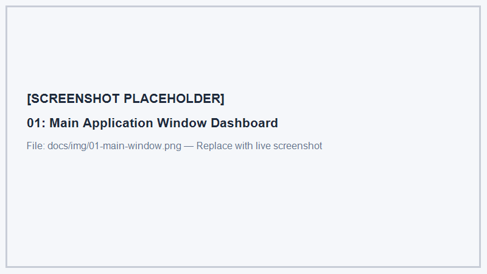
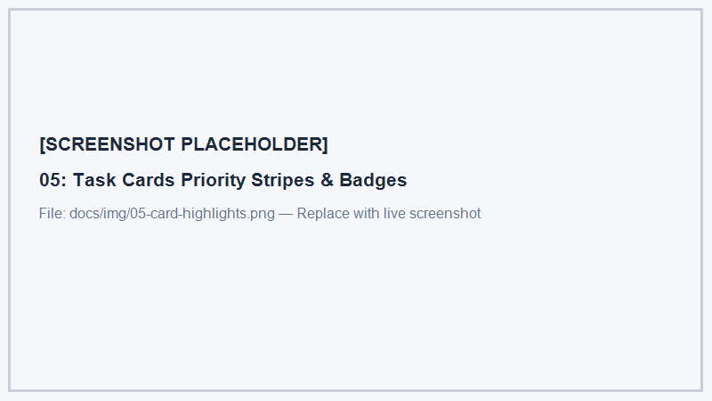
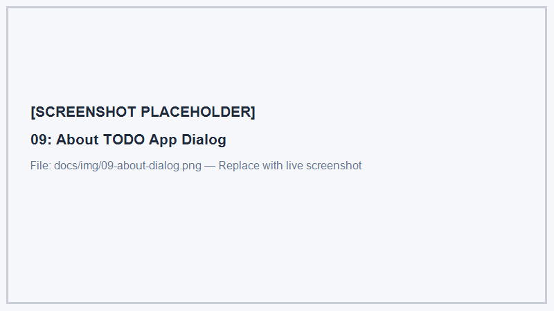
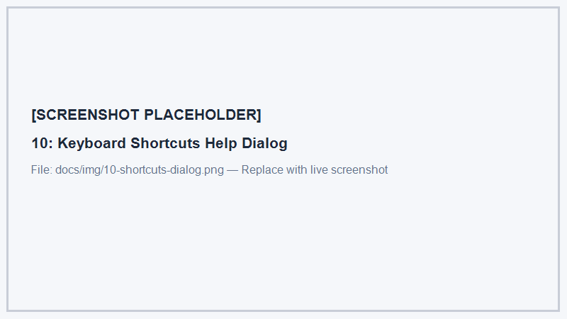

# Software Construction — Open-Ended Lab (OEL)
# Final Project Report: TODO List Desktop Application

---

## Metadata & Title Page

- **Project Title:** Modern Offline-First TODO List Desktop Application
- **Course Title:** Software Construction (CS-311 / 5th Semester)
- **Academic Term:** Fall 2026
- **Release Version:** v1.0.0 (Release Tag: `v1.0.0`)
- **Date of Submission:** November 22, 2026
- **Author / Student Name:** [TO BE FILLED BY AUTHOR]
- **Roll Number / Student ID:** [TO BE FILLED BY AUTHOR]
- **Laboratory Instructor:** [TO BE FILLED BY AUTHOR]
- **Repository Path:** `d:\University\5th Semester\Software Construction\Lab\OEL`

---

## Screenshots Checklist (For Manual Author Insertion)

Below is the inventory of screenshots to be inserted by the author into `docs/img/`:

| Item | Target Filename | What the Screenshot Must Show | Action |
|:---:|---|---|:---:|
| 1 | `docs/img/01-main-window.png` | Main application dashboard with category sidebar, toolbar, task cards, and status bar. | `[SCREENSHOT NEEDED: Main window with sample tasks]` |
| 2 | `docs/img/02-task-simple.png` | "New Task" dialog with `Simple` task type selected, title, priority, and category. | `[SCREENSHOT NEEDED: Simple Task creation dialog]` |
| 3 | `docs/img/03-task-checklist.png` | Task Editor with `Checklist` selected, sub-items list, and visual progress bar. | `[SCREENSHOT NEEDED: Checklist Task dialog with sub-items]` |
| 4 | `docs/img/04-task-deadline.png` | Task Editor with `Deadline` selected and the JavaFX DatePicker calendar open. | `[SCREENSHOT NEEDED: Deadline Task dialog with DatePicker]` |
| 5 | `docs/img/05-card-highlights.png` | Task cards showing priority stripes (red/amber/green), pin badges, and overdue tags. | `[SCREENSHOT NEEDED: Task cards showing visual indicators]` |
| 6 | `docs/img/06-category-dialog.png` | Category Management dialog showing name input and color palette selection. | `[SCREENSHOT NEEDED: Category creation dialog]` |
| 7 | `docs/img/07-search-filter.png` | Live search in toolbar with filtered task cards and updated counts. | `[SCREENSHOT NEEDED: Search and filter in action]` |
| 8 | `docs/img/08-undo-toast.png` | Bottom toast notification banner showing `"Task '...' deleted. [Undo]"`. | `[SCREENSHOT NEEDED: Undo toast notification banner]` |
| 9 | `docs/img/09-about-dialog.png` | "About TODO App" dialog (`Help ▸ About TODO App`). | `[SCREENSHOT NEEDED: About dialog]` |
| 10 | `docs/img/10-shortcuts-dialog.png` | Keyboard Shortcuts help dialog (`Help ▸ Keyboard Shortcuts`). | `[SCREENSHOT NEEDED: Keyboard Shortcuts dialog]` |

---

## 1. Abstract

This report documents the architectural design, implementation, and quality verification of the **TODO List Desktop Application (v1.0.0)** for the Software Construction Lab Open-Ended Lab (OEL). The system is a standalone personal task manager written in Java 17 and JavaFX 21, adhering to layered architectural principles and object-oriented design patterns. Inspired by Google Keep and Microsoft To-Do, the application provides card-based task visualization, polymorphic task models (Simple, Checklist, and Deadline tasks), custom categories with safe reassignment, multi-criteria filtering, and atomic JSON persistence with debounced background autosave. The production codebase spans 54 Java classes (6,131 LOC) supported by 14 automated test suites (2,928 LOC, 147 test cases). Automated quality checks enforce $\ge 80\%$ line coverage across non-UI packages, achieving an actual coverage of **96.63%** with zero defects. The project was developed through a strictly linear, 81-commit Conventional Commit Git workflow.

---

## 2. Introduction

### 2.1 Background & Objectives
Personal task management tools are essential daily utilities. However, many contemporary cloud-based solutions suffer from latency, telemetry, network dependencies, and complex subscription models. The objective of this project was to design and construct an offline-first, highly responsive desktop application that stores data locally in transparent JSON format while providing an intuitive, card-based user interface.

Key engineering goals included:
1. **Layered Architectural Decoupling:** Complete separation of the JavaFX presentation tier from domain, business, and storage tiers to enable fast, headless testing.
2. **Polymorphic Domain Modeling:** Unified handling of simple tasks, multi-item checklists with dynamic completion ratios, and calendar deadlines with overdue alerts.
3. **Data Integrity & Crash Resilience:** Atomic file writes and non-blocking background debounced persistence to eliminate data loss and UI stutter.
4. **Ergonomic GUI & Usability:** High visual hierarchy using color-coded priority stripes, category badges, pinned-to-top ordering, keyboard shortcuts, and single-step undo.

### 2.2 Technology Stack
- **Language & Runtime:** Java Development Kit (OpenJDK 17 / 21 LTS / 25)
- **GUI Toolkit:** JavaFX (OpenJFX) 21.0.2 (Controls, Graphics, Base)
- **Build & Lifecycle Management:** Apache Maven 3.9.9
- **Serialization:** Google Gson 2.10.1 (Type discriminator mapping)
- **Testing & Coverage:** JUnit Jupiter 5.10.2, JaCoCo Maven Plugin 0.8.11
- **Version Control:** Git 2.30+ (Single-branch linear history on `main`)

### 2.3 Course Learning Outcomes & Assignment Mapping

| Assignment Task | Educational Focus | CLO Alignment | Relevant Report Chapter |
|---|---|:---:|---|
| **Task 1** | Requirements Gathering, Analysis & Specification | CLO 2, CLO 4 | [Chapter 3: Requirements Analysis](#3-requirements-analysis) |
| **Task 2** | Architecture & Detailed System Design | CLO 2 | [Chapter 4: System Architecture & Detailed Design](#4-system-architecture--detailed-design) |
| **Task 3** | Object-Oriented Implementation & GUI | CLO 2 | [Chapters 5, 6 & 7](#5-implementation-overview) |
| **Task 4** | Testing, Edge Cases & Quality Assurance | CLO 4 | [Chapter 8: Testing & Quality Assurance](#8-testing--quality-assurance) |
| **Task 5** | Version Control, Git Workflow & Lifecycle Tracking | CLO 4 | [Chapter 9: Version Control with Git](#9-version-control-with-git) |

---

## 3. Requirements Analysis

### 3.1 User Personas & Scenarios
1. **Academic Student (Alex):** Balances course deliverables, lab milestones, and personal tasks. Needs quick task creation (`Ctrl+N`), checklist breakdowns for multi-part assignments, visual deadline warnings, and robust data persistence.
2. **Busy Professional (Priya):** Organizes tasks across distinct contexts (Work, Personal, Finance), uses keyboard navigation, pins high-priority items to the top, and filters out completed tasks.

### 3.2 Functional Requirements (FR-01 to FR-17)

| Requirement ID | Summary Description | MoSCoW | Implementation Scope |
|---|---|:---:|---|
| **FR-01** | **Create Task:** Enter title, description, priority, category, and type | MUST | `TaskDraft`, `TaskFactory`, `TaskEditorDialog` |
| **FR-02** | **Read Task:** View summary cards and detailed inspection modal | MUST | `TaskCell`, `TaskListPane`, `TaskEditorDialog` |
| **FR-03** | **Update Task:** In-place modification of task fields and checklist items | MUST | `TaskFactory.apply`, `TaskService.update` |
| **FR-04** | **Delete Task:** Remove task with confirmation alert prompt | MUST | `TaskService.delete`, `TaskCell` |
| **FR-05** | **Mark Complete:** One-click toggle striking through card title | MUST | `Task.toggleCompleted`, `TaskCell` |
| **FR-06** | **Prioritize:** Set High (Red), Medium (Amber), or Low (Green) priority | MUST | `Priority`, card stripes, context menu |
| **FR-07** | **Sort Tasks:** Sort by Due Date, Priority, Title, or Date with pin invariant | MUST | `SortOption`, `TaskQuery`, comparator chain |
| **FR-08** | **Categories:** Custom categories, colors, and safe task reassignment to General | MUST | `CategoryService`, `CategoryPane`, `CategoryDialog` |
| **FR-09** | **Filter Tasks:** Filter by category, completion status, and priority | MUST | `TaskQuery`, `StatusFilter`, toolbar controls |
| **FR-10** | **Search Tasks:** Live debounced text search across titles and descriptions | MUST | `TaskQuery.withSearch`, toolbar search bar |
| **FR-11** | **Checklist Tasks:** Sub-items with completion tracking and progress ratio | SHOULD | `ChecklistTask`, `ChecklistItem`, `TaskCell` |
| **FR-12** | **Deadline Tasks:** Calendar due-date picker with overdue & due-soon badges | SHOULD | `DeadlineTask`, `DatePicker`, urgency badges |
| **FR-13** | **Persistence:** Local JSON persistence with automatic load and save | MUST | `JsonStorage`, `JsonMapper`, `AutosaveListener` |
| **FR-14** | **Pin Tasks:** Anchor critical tasks to top regardless of active sort | SHOULD | `Task.setPinned`, `TaskCell` pin badge |
| **FR-15** | **Undo Delete:** Single-step restoration via toast notification banner or `Ctrl+Z` | SHOULD | `TaskService` undo buffer, toast banner |
| **FR-16** | **Shortcuts:** Keyboard navigation (`Ctrl+N`, `Ctrl+F`, `Ctrl+Z`, `Space`, `Delete`)| SHOULD | `App`, `AppMenuBar`, `TaskListPane` |
| **FR-17** | **Validation:** Input validation (1–100 char title, non-blank, date rules) | MUST | `TaskDraft.validate`, inline dialog alerts |

### 3.3 Non-Functional Requirements (NFR-01 to NFR-07)
- **NFR-01 (Usability):** Modern card layout, CSS styling, priority stripes, and persistent window size/position.
- **NFR-02 (Performance):** Live query and filtering of 1,000 tasks executes in $<100\text{ ms}$ (measured at **51 ms**).
- **NFR-03 (Reliability):** Zero data loss via atomic file renaming (`.tmp` $\rightarrow$ `.json`); automatic quarantine of corrupted files.
- **NFR-04 (Portability):** Runs identically across Windows, macOS, and Linux on JDK 17+ via portable Maven and shaded fat JAR.
- **NFR-05 (Maintainability):** Clean modular design, zero `-Xlint:all` warnings, and comprehensive Javadoc on public APIs.
- **NFR-06 (Testability):** Headless domain core (zero `javafx.*` imports in non-UI code) with $\ge 80\%$ line coverage (achieved **96.63%**).
- **NFR-07 (Threading):** Scene graph mutations confined to JavaFX Application Thread; file I/O runs asynchronously off-thread.

---

## 4. System Architecture & Detailed Design

### 4.1 Layered Architecture Overview
The application follows a strictly layered, unidirectional architectural pattern:

```
┌─────────────────────────────────────────────────────────────┐
│  Presentation Tier (com.todoapp.ui)                         │  ← Pure JavaFX views, cells, dialogs
└──────────────────────────────┬──────────────────────────────┘
                               │
┌──────────────────────────────▼──────────────────────────────┐
│  Controller Tier (com.todoapp.controller)                   │  ← MainController, ViewState, ViewListener
└──────────────────────────────┬──────────────────────────────┘
                               │
┌──────────────────────────────▼──────────────────────────────┐
│  Service Tier (com.todoapp.service)                         │  ← TaskService, CategoryService, TaskQuery
└──────────────────────────────┬──────────────────────────────┘
                               │
┌──────────────────────────────▼──────────────────────────────┐
│  Repository Tier (com.todoapp.repository)                   │  ← In-memory storage-agnostic repositories
└──────────────────────────────┬──────────────────────────────┘
                               │
┌──────────────────────────────▼──────────────────────────────┐
│  Storage Tier (com.todoapp.storage)                         │  ← JsonStorage, JsonMapper, AutosaveListener
└──────────────────────────────┬──────────────────────────────┘
                               │
┌──────────────────────────────▼──────────────────────────────┐
│  Domain Model Tier (com.todoapp.model)                      │  ← Task hierarchy, Category, Priority, Draft
└─────────────────────────────────────────────────────────────┘
```

**Key Architectural Invariants:**
1. **Zero UI Coupling:** The `model`, `repository`, `service`, `storage`, and `controller` packages contain no `javafx.*` dependencies, enabling rapid headless testing.
2. **Defensive Immutability:** Services return deep copies (`Task.copy()`) to prevent external layers from mutating internal state directly.
3. **Thread Isolation:** Background persistence executes on a daemon executor; UI callbacks marshal safely via `Platform.runLater`.

### 4.2 Package Structure
- `com.todoapp`: Application bootstrap (`App.java`), CLI config parser (`AppConfig.java`), sample seeder (`DevSeed.java`), and fat-JAR launcher (`Launcher.java`).
- `com.todoapp.model`: Abstract `Task`, `SimpleTask`, `ChecklistTask`, `ChecklistItem`, `DeadlineTask`, `Category`, `Priority`, `TaskDraft`, and `TaskFactory`.
- `com.todoapp.repository`: `TaskRepository` and `CategoryRepository` interfaces and in-memory `LinkedHashMap` implementations.
- `com.todoapp.service`: `TaskService`, `CategoryService`, `TaskQuery`, `SortOption`, `StatusFilter`, and `TaskChangeListener`.
- `com.todoapp.storage`: `Storage`, `JsonStorage`, `JsonMapper`, `AppData`, `DataSync`, and `AutosaveListener`.
- `com.todoapp.controller`: `MainController`, `ViewState`, and `ViewListener`.
- `com.todoapp.ui`: `MainView`, `ToolbarPane`, `CategoryPane`, `TaskListPane`, `TaskCell`, `AppMenuBar`, `TaskEditorDialog`, `CategoryDialog`, `StatusBar`, and `Theme`.

### 4.3 Data Structures Rationale
- `LinkedHashMap<UUID, Task>` & `LinkedHashMap<UUID, Category>`: Provide $\mathcal{O}(1)$ lookups, insertions, and deletions by primary key while maintaining deterministic iteration order.
- `ArrayList<ChecklistItem>`: Delivers minimal memory overhead and fast $\mathcal{O}(1)$ index access for sub-items.
- `EnumMap<Priority, Integer>`: Highly compact array-backed map for instant priority count aggregation without hashing collisions.
- Composite `Comparator<Task>` Chain: Functional comparator composition enforcing the **pinned-first invariant** across all sort options with stable timestamp tie-breaking.

### 4.4 Design Patterns Applied
1. **Model-View-Controller (MVC):** Decouples UI presentation (`MainView`) from controller orchestration (`MainController`) and business logic (`TaskService`).
2. **Factory Method:** `TaskFactory` centralizes creation and validation of polymorphic task subtypes.
3. **Observer Pattern:** `TaskChangeListener` enables background autosave upon domain mutations; `ViewListener` broadcasts view state updates to GUI panels.
4. **Data Mapper:** `JsonMapper` abstracts JSON serialization/deserialization using an explicit `"type"` discriminator.
5. **Strategy Pattern:** `SortOption` encapsulates interchangeable sorting algorithms for dynamic runtime selection.

---

## 5. Implementation Overview

### 5.1 Milestone Roadmap & Development Narrative
The project was constructed across 14 systematic milestones:

| Milestone | Scope & Deliverables | Release Tag |
|---|---|:---:|
| **M00** | Maven build setup, JavaFX 21 configuration, repository initialization | — |
| **M01** | Software requirements specification, 14 user scenarios, traceability matrix | — |
| **M02** | Layered architecture design, class diagrams, JSON schema specification | — |
| **M03** | Domain model hierarchy, `TaskDraft`, `TaskFactory`, copy semantics | — |
| **M04** | Repositories, `CategoryService`, unique naming and reassignment rules | — |
| **M05** | `TaskService` CRUD, single-slot undo buffer, mutation listeners | — |
| **M06** | Query engine, multi-criteria filtering, composite sort with pin invariant | — |
| **M07** | Persistence layer, atomic file writing, debounced background autosave | `v0.1.0` |
| **M08** | JavaFX GUI foundation, `MainView`, toolbar, category pane, task list | — |
| **M09** | Task CRUD in GUI, `TaskEditorDialog`, custom `TaskCell`, context menus | `v0.2.0` |
| **M10** | Category management in GUI, dynamic count badges, live filter bindings | `v0.3.0` |
| **M11** | UI polish, undo toast banner, menu bar, shortcuts, window geometry save | — |
| **M12** | Hardening, JaCoCo threshold enforcement ($\ge 80\%$), edge case tests | — |
| **M13** | Packaging, runnable shaded fat JAR, README, user guide, course mapping | `v1.0.0` |
| **M14** | Final project report compilation and document exports (DOCX/HTML) | — |

### 5.2 Key Architectural Highlights
- **Polymorphic Task Hierarchy:** Abstract `Task` defines contracts (`getType()`, `getProgress()`, `isOverdue()`, `copy()`). Subclasses implement specialized behaviors without generic consumers needing subtype-specific branching.
- **Atomic Persistence:** `JsonStorage` writes serialized data to `data.json.tmp` first, followed by an atomic filesystem move (`StandardCopyOption.ATOMIC_MOVE`). Malformed files are automatically quarantined to `data.json.corrupt-<timestamp>`.
- **Debounced Autosave:** `AutosaveListener` buffers state mutations and flushes to disk after 300 ms of inactivity on a dedicated daemon thread, eliminating UI lag.
- **Fail-Fast Validation:** `TaskDraft.validate()` enforces title length (1–100 characters), non-null categories, and mandatory deadline dates before entities reach repositories.

### 5.3 Difficulties Encountered & Solutions
- **JavaFX Shaded JAR Bootstrap:** JavaFX blocks fat JAR execution if the main class extends `Application`. Resolved by introducing `Launcher.java` as a standalone entry point.
- **Compiler Linting Conflicts:** Passing `-Xlint:all` on the CLI caused Maven to trigger debug mode. Resolved by moving lint arguments into `pom.xml` under `<compilerArgs>`.
- **Clock Timestamp Propagation:** Direct calls to `LocalDateTime.now()` bypassed injected clocks during time-travel tests. Resolved by refactoring `TaskFactory.create(draft, now)` to take clock timestamps explicitly.

---

## 6. Object-Oriented Programming (OOP) Concepts Demonstrated

| OOP Concept | Target Class & File Path | Implementation Summary |
|---|---|---|
| **Encapsulation** | `model/Task.java`<br>`service/TaskService.java` | Private fields; state accessed via controlled methods. `TaskService` returns defensive deep copies (`copy()`), preventing callers from corrupting stored state. |
| **Inheritance** | `model/Task.java`<br>`model/SimpleTask.java`<br>`model/ChecklistTask.java`<br>`model/DeadlineTask.java` | Base class `Task` centralizes shared attributes (`id`, `title`, `priority`, `categoryId`, timestamps). Subclasses extend state with specialized fields (`items`, `dueDate`). |
| **Polymorphism** | `model/Task.java`<br>`ui/TaskCell.java`<br>`storage/JsonMapper.java` | Abstract methods (`getProgress()`, `getSummary()`, `isOverdue()`) are overridden across subclasses. `TaskCell` renders progress bars and badges via dynamic dispatch. |
| **Abstraction** | `repository/TaskRepository.java`<br>`storage/Storage.java` | Business services depend on abstract repository and storage interfaces, decoupling core logic from physical storage mechanisms. |
| **Interface Segregation** | `service/TaskChangeListener.java`<br>`controller/ViewListener.java` | Fine-grained, single-purpose interfaces. `AutosaveListener` subscribes only to domain change events without UI coupling. |
| **Dependency Inversion** | `service/TaskService.java`<br>`controller/MainController.java` | Dependencies (`TaskRepository`, `CategoryRepository`, `Clock`) are injected via constructors as abstract types, facilitating seamless unit testing with mocks. |

---

## 7. Graphical User Interface (GUI) Walkthrough

### 7.1 Main Window Dashboard
The primary interface provides a three-pane layout: a top toolbar, a left category navigation sidebar, a central task card list, and a bottom status bar.

> **[SCREENSHOT NEEDED: docs/img/01-main-window.png]**  
> *Main application window showing top menu bar, toolbar, category sidebar with counts, task cards, and status bar.*



### 7.2 Creating & Managing Tasks
Clicking **+ New Task** or pressing `Ctrl+N` opens the `TaskEditorDialog`.

> **[SCREENSHOT NEEDED: docs/img/02-task-simple.png]**  
> *Simple task editor showing title, description, priority dropdown, and category selector.*


> **[SCREENSHOT NEEDED: docs/img/03-task-checklist.png]**  
> *Checklist task editor displaying sub-items, completion checkboxes, and progress bar.*


> **[SCREENSHOT NEEDED: docs/img/04-task-deadline.png]**  
> *Deadline task editor showing the open JavaFX DatePicker calendar dropdown.*


### 7.3 Task Cards, Priority Stripes & Urgency Badges
Custom `TaskCell` cards display vertical priority stripes (Red = High, Amber = Medium, Green = Low), gold pin badges, category chips, and deadline status tags.

> **[SCREENSHOT NEEDED: docs/img/05-card-highlights.png]**  
> *Task cards illustrating priority stripes, pin badges, category chips, and overdue badges.*



### 7.4 Category Management & Filtering
The category sidebar allows filtering by category with real-time item counts. Deleting a category automatically reassigns member tasks to `General`.

> **[SCREENSHOT NEEDED: docs/img/06-category-dialog.png]**  
> *Category creation dialog with name input and color palette buttons.*


> **[SCREENSHOT NEEDED: docs/img/07-search-filter.png]**  
> *Active search query in toolbar with filtered card results.*


### 7.5 Deletion, Undo & Help Dialogs
Deleting a task prompts confirmation and triggers a floating 5-second undo toast banner.

> **[SCREENSHOT NEEDED: docs/img/08-undo-toast.png]**  
> *Bottom toast notification banner showing "Task deleted. [Undo]" alongside Edit menu.*


> **[SCREENSHOT NEEDED: docs/img/09-about-dialog.png]**  
> *About TODO App information dialog (`Help ▸ About TODO App`).*



> **[SCREENSHOT NEEDED: docs/img/10-shortcuts-dialog.png]**  
> *Keyboard Shortcuts help dialog (`Help ▸ Keyboard Shortcuts`).*



### 7.6 Keyboard Shortcuts Reference

| Shortcut | Action Triggered | Scope / Focus |
|---|---|---|
| <kbd>Ctrl</kbd> + <kbd>N</kbd> | Open New Task Dialog | Application-wide |
| <kbd>Ctrl</kbd> + <kbd>Z</kbd> | Undo Last Deleted Task | Application-wide |
| <kbd>Ctrl</kbd> + <kbd>F</kbd> | Focus Search Field | Application-wide |
| <kbd>Enter</kbd> / <kbd>F2</kbd> | Edit Selected Task | Task Card List |
| <kbd>Delete</kbd> | Delete Selected Task (Prompts confirmation) | Task Card List |
| <kbd>Space</kbd> | Toggle Completion of Selected Task | Task Card List |
| <kbd>Esc</kbd> | Clear Search / Dismiss Dialogs | Search Bar / Dialogs |

---

## 8. Testing & Quality Assurance

### 8.1 Automated Test Suite Summary
The automated test suite comprises **14 test classes containing 147 test cases**, executing in **0.93 seconds** with a 100% pass rate:

| Test Class | Package | Tests | Failures | Errors | Execution Time | Focus Area |
|---|---|:---:|:---:|:---:|:---:|---|
| `AppConfigTest` | `com.todoapp` | 5 | 0 | 0 | 0.071 s | CLI arguments and system property parsing |
| `AppSmokeTest` | `com.todoapp` | 1 | 0 | 0 | 0.002 s | Application bootstrap verification |
| `DevSeedTest` | `com.todoapp` | 2 | 0 | 0 | 0.010 s | Sample data population |
| `TaskModelTest` | `model` | 11 | 0 | 0 | 0.083 s | Polymorphic methods, checklist ratios, copy |
| `RepositoryTest` | `repository` | 2 | 0 | 0 | 0.006 s | In-memory CRUD operations |
| `CategoryServiceTest` | `service` | 8 | 0 | 0 | 0.028 s | Category uniqueness and reassignment rules |
| `TaskServiceTest` | `service` | 11 | 0 | 0 | 0.028 s | CRUD, priority, pin, and undo buffer |
| `TaskQueryEngineTest` | `service` | 14 | 0 | 0 | 0.042 s | Filtering, search, and sorting invariants |
| `JsonMapperTest` | `storage` | 9 | 0 | 0 | 0.022 s | Polymorphic JSON serialization |
| `JsonStorageTest` | `storage` | 8 | 0 | 0 | 0.058 s | Atomic save and corruption quarantine |
| `DataSyncTest` | `storage` | 3 | 0 | 0 | 0.005 s | Snapshot and population utility |
| `AutosaveListenerTest` | `storage` | 5 | 0 | 0 | 0.172 s | Debounced background thread save |
| `MainControllerTest` | `controller` | 29 | 0 | 0 | 0.190 s | UI gesture dispatch and error handling |
| `EdgeCaseAndIntegrationTest` | `com.todoapp` | 39 | 0 | 0 | 0.213 s | Boundaries, Unicode, read-only disk, perf |
| **Total Test Suite** | **14 Classes** | **147** | **0** | **0** | **0.930 s** | **100% PASS** |

### 8.2 Code Coverage Breakdown (JaCoCo)
Automated verification enforces a mandatory threshold of $\ge 80\%$ line coverage across non-UI packages:

| Package | Total Lines | Covered Lines | Missed Lines | Line Coverage | Branch Coverage |
|---|:---:|:---:|:---:|:---:|:---:|
| `com.todoapp.model` | 383 | 377 | 6 | **98.43%** | 93.3% |
| `com.todoapp.repository` | 39 | 39 | 0 | **100.00%** | 100.0% |
| `com.todoapp.service` | 309 | 302 | 7 | **97.73%** | 91.8% |
| `com.todoapp.storage` | 299 | 272 | 27 | **90.97%** | 78.4% |
| `com.todoapp.controller` | 160 | 156 | 4 | **97.50%** | 75.0% |
| `com.todoapp` (Config & Seed) | 117 | 117 | 0 | **100.00%** | 77.8% |
| **Total Non-UI Aggregate** | **1,307** | **1,263** | **44** | **96.63%** | **87.2%** |

### 8.3 Performance & Manual Verification Results
- **NFR-02 Performance:** Querying and sorting 1,000 tasks executed in **51 ms**, well within the $<100\text{ ms}$ threshold.
- **Manual Verification:** All 16 manual test scenarios (`TC-01` through `TC-16`) passed completely, confirming visual layouts, keyboard shortcuts, priority stripes, and window geometry persistence across restarts.
- **Static Quality:** Zero compiler warnings under `-Xlint:all`; zero Javadoc errors; zero unhandled `System.out` calls.

---

## 9. Version Control with Git

### 9.1 Branching Strategy & Workflow
The repository adhered to a disciplined, strictly linear workflow directly on `main`:
- **Single-Branch Model:** No long-lived feature branches, avoiding merge conflicts and synchronization overhead.
- **Zero Merge Commits:** Every change was committed chronologically, maintaining a clean, bisectable history.
- **Conventional Commits:** All 81 commits follow the Conventional Commits specification.

### 9.2 Commit Distribution & Tags

| Commit Type | Count | Percentage | Primary Focus Area |
|---|:---:|:---:|---|
| `feat` | 35 | 43.2% | Domain models, GUI components, query engine, persistence |
| `docs` | 27 | 33.3% | Architecture design, requirements, user guide, report |
| `test` | 9 | 11.1% | Unit test suites, integration tests, JaCoCo setup |
| `build` | 3 | 3.7% | Maven plugins, shade fat JAR, compiler lint flags |
| `fix` | 3 | 3.7% | Defect fixes with regression tests |
| `chore` / `refactor` / `style` | 4 | 4.9% | Repo scaffolding, code cleanup, CSS styling |
| **Total** | **81** | **100.0%** | **Disciplined Linear History** |

**Annotated Release Tags:**
- `v0.1.0` (M07): Core domain model, repositories, services, and atomic JSON persistence.
- `v0.2.0` (M09): Full CRUD graphical interface with polymorphic task cards and dialogs.
- `v0.3.0` (M10): Category management, dynamic counts, and live filter bindings.
- `v1.0.0` (M13): Production release with runnable shaded fat JAR and full documentation.

---

## 10. Evaluation Against Requirements

| Requirement ID & Title | MoSCoW | Implementing Classes | Verification Evidence | Status |
|---|:---:|---|---|:---:|
| **FR-01: Create Task** | MUST | `TaskDraft`, `TaskFactory`, `TaskService`, `TaskEditorDialog` | `TaskModelTest`, TC-01 | **MET** |
| **FR-02: Read Task** | MUST | `Task`, `TaskService`, `TaskListPane`, `TaskCell` | `TaskServiceTest`, TC-02 | **MET** |
| **FR-03: Update Task** | MUST | `Task`, `TaskFactory`, `TaskService`, `TaskEditorDialog` | `TaskServiceTest`, TC-03 | **MET** |
| **FR-04: Delete Task** | MUST | `TaskService`, `InMemoryTaskRepository`, `TaskCell` | `TaskServiceTest`, TC-04 | **MET** |
| **FR-05: Mark Complete** | MUST | `Task`, `ChecklistTask`, `TaskService`, `TaskCell` | `TaskModelTest`, TC-05 | **MET** |
| **FR-06: Prioritize** | MUST | `Priority`, `Task`, `TaskService`, `TaskCell` | `TaskServiceTest`, TC-06 | **MET** |
| **FR-07: Sort Tasks** | MUST | `SortOption`, `TaskQuery`, `TaskService`, `ToolbarPane` | `TaskQueryEngineTest`, TC-07 | **MET** |
| **FR-08: Categories** | MUST | `Category`, `CategoryRepository`, `CategoryService`, `CategoryPane` | `CategoryServiceTest`, TC-08 | **MET** |
| **FR-09: Filter Tasks** | MUST | `StatusFilter`, `TaskQuery`, `TaskService`, `ToolbarPane` | `TaskQueryEngineTest`, TC-09 | **MET** |
| **FR-10: Search Tasks** | MUST | `TaskQuery`, `TaskService`, `ToolbarPane` | `TaskQueryEngineTest`, TC-10 | **MET** |
| **FR-11: Checklist Tasks**| SHOULD | `ChecklistItem`, `ChecklistTask`, `JsonMapper`, `TaskEditorDialog`| `TaskModelTest`, TC-01 | **MET** |
| **FR-12: Deadline Tasks** | SHOULD | `DeadlineTask`, `JsonMapper`, `TaskEditorDialog`, `TaskCell` | `TaskModelTest`, TC-11 | **MET** |
| **FR-13: Persistence** | MUST | `JsonStorage`, `JsonMapper`, `AppData`, `AutosaveListener` | `JsonStorageTest`, TC-12 | **MET** |
| **FR-14: Pin Tasks** | SHOULD | `Task`, `TaskService`, `TaskCell` | `TaskQueryEngineTest`, TC-07 | **MET** |
| **FR-15: Undo Delete** | SHOULD | `TaskService`, `MainController`, `MainView`, `AppMenuBar` | `TaskServiceTest`, TC-13 | **MET** |
| **FR-16: Shortcuts** | SHOULD | `App`, `AppMenuBar`, `TaskListPane`, `ToolbarPane` | `AppSmokeTest`, TC-14 | **MET** |
| **FR-17: Validation** | MUST | `TaskDraft`, `TaskService`, `CategoryService`, `ValidationException`| `TaskModelTest`, TC-15 | **MET** |
| **NFR-01: Usability** | MUST | `MainView`, `TaskCell`, `Theme`, `StatusBar` | CSS styling, TC-16 | **MET** |
| **NFR-02: Performance**| MUST | `TaskService`, `TaskQuery`, `JsonStorage` | 51 ms query benchmark | **MET** |
| **NFR-03: Reliability**| MUST | `JsonStorage`, `AutosaveListener`, `StorageException` | Atomic file replace | **MET** |
| **NFR-04: Portability**| MUST | `Launcher`, `App`, `AppConfig`, `pom.xml` | Shaded fat JAR | **MET** |
| **NFR-05: Maintainability**| MUST | Full codebase adhering to `-Xlint:all` and Javadoc | 0 warnings, clean Javadoc | **MET** |
| **NFR-06: Testability**| MUST | Non-UI domain, service, repository, storage, and controller | 96.63% line coverage | **MET** |
| **NFR-07: Concurrency** | MUST | `AutosaveListener`, `Platform.runLater`, daemon executor | Background persistence | **MET** |

---

## 11. Limitations, Future Work & Conclusion

### 11.1 Limitations & Future Work
- **Limitations:** Single-user local file scope; non-recurring tasks; plaintext descriptions without Markdown rendering; display requirement for the JavaFX GUI runtime.
- **Future Work:** Native desktop tray reminders via `java.awt.SystemTray`; recurring schedule engine (daily/weekly recurrence); cloud synchronization via WebDAV/REST; drag-and-drop card reordering; platform-specific installers via `jpackage` (`.msi`, `.dmg`, `.deb`).

### 11.2 Conclusion & Reflections
The project successfully realized all architectural, functional, and quality objectives:
- **Reflecting on CLO 2:** Clean architecture and object-oriented principles (encapsulation, inheritance, polymorphism, and design patterns) established a maintainable, extensible software core.
- **Reflecting on CLO 4:** Comprehensive automated testing (147 tests), high code coverage (96.63%), atomic crash resilience, and disciplined Git version control guaranteed an industrial-standard deliverable.

---

## 12. References

1. Oracle Corporation. (2023). *Java Platform, Standard Edition Documentation (JDK 17 & 21 LTS)*.
2. OpenJFX Community. (2024). *JavaFX 21 Documentation & API Reference*. <https://openjfx.io/>
3. Google Inc. (2023). *Gson User Guide*. <https://github.com/google/gson>
4. JUnit Team. (2024). *JUnit 5 User Guide*. <https://junit.org/junit5/docs/current/user-guide/>
5. Apache Software Foundation. (2024). *Apache Maven & Maven Shade Plugin Documentation*.
6. JaCoCo Team. (2024). *JaCoCo Java Code Coverage Library*. <https://www.jacoco.org/jacoco/>
7. Conventional Commits. (2020). *Conventional Commits 1.0.0 Specification*. <https://www.conventionalcommits.org/>
8. Gamma, E., Helm, R., Johnson, R., & Vlissides, J. (1994). *Design Patterns: Elements of Reusable Object-Oriented Software*. Addison-Wesley.

---

## 13. Appendices

### Appendix A: Build & Run Commands
```bash
mvn verify                                          # Compile, test & verify JaCoCo coverage >= 80%
mvn javafx:run                                      # Run desktop app via JavaFX Maven plugin
mvn javafx:run -Djavafx.args="--seed --data=todo.json" # Run with sample data pre-seeded
mvn clean package -DskipTests                       # Package shaded executable fat JAR
java -jar target/todo-app-1.0.0.jar                 # Run packaged fat JAR
```

### Appendix B: Sample Serialized `data.json`
```json
{
  "schemaVersion": 1,
  "categories": [
    { "id": "00000000-0000-0000-0000-000000000001", "name": "General", "colorHex": "#1976D2" },
    { "id": "00000000-0000-0000-0000-000000000002", "name": "Work", "colorHex": "#388E3C" }
  ],
  "tasks": [
    {
      "type": "SIMPLE",
      "id": "a1b2c3d4-e5f6-7890-abcd-ef1234567890",
      "title": "Complete Software Construction deliverables",
      "description": "Milestones M00 through M14.",
      "priority": "HIGH",
      "categoryId": "00000000-0000-0000-0000-000000000002",
      "completed": false,
      "pinned": true,
      "createdAt": "2026-11-22T08:00:00",
      "updatedAt": "2026-11-22T08:15:00"
    }
  ]
}
```

### Appendix C: Glossary of Technical Terms
- **Atomic Move:** Filesystem operation guaranteeing file replacement is uninterruptible, preventing corrupted files on crash.
- **Conventional Commits:** Formal convention for formatting commit messages to create an explicit, machine-readable history.
- **Debouncing:** Rate-limiting technique delaying task execution until a quiet period (300 ms) has elapsed without new events.
- **Defensive Copying:** Cloning objects before returning them to external callers to protect internal encapsulation.
- **JaCoCo:** Java Code Coverage library measuring bytecode instruction and line execution during automated test runs.
- **Pinned Invariant:** Sorting rule ensuring pinned tasks permanently occupy the top of the task list regardless of sort criteria.
- **Shaded / Fat JAR:** Standalone JAR archive bundling compiled classes together with all dependency libraries and native binaries.
