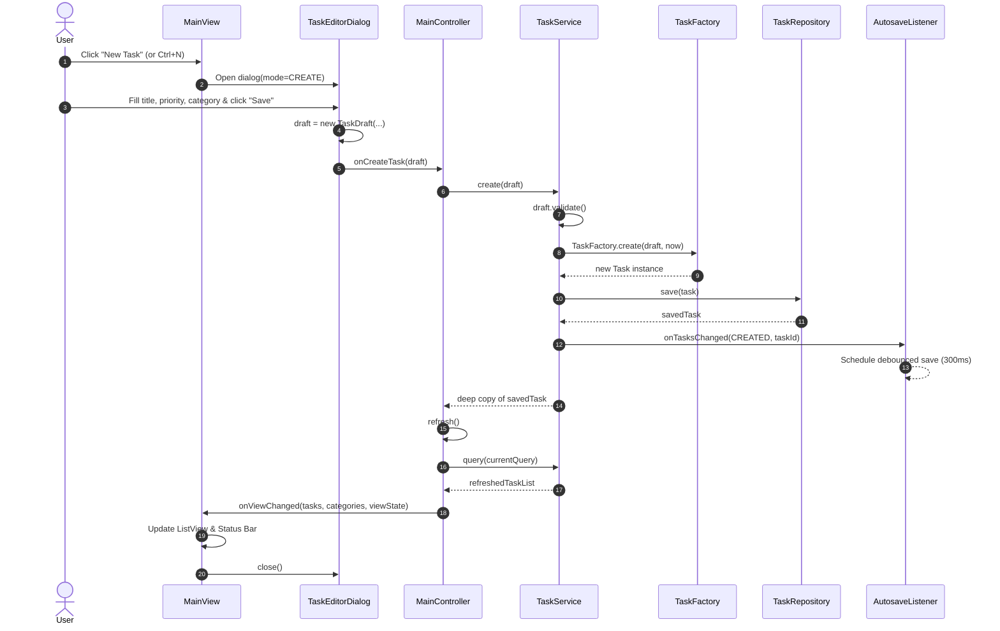
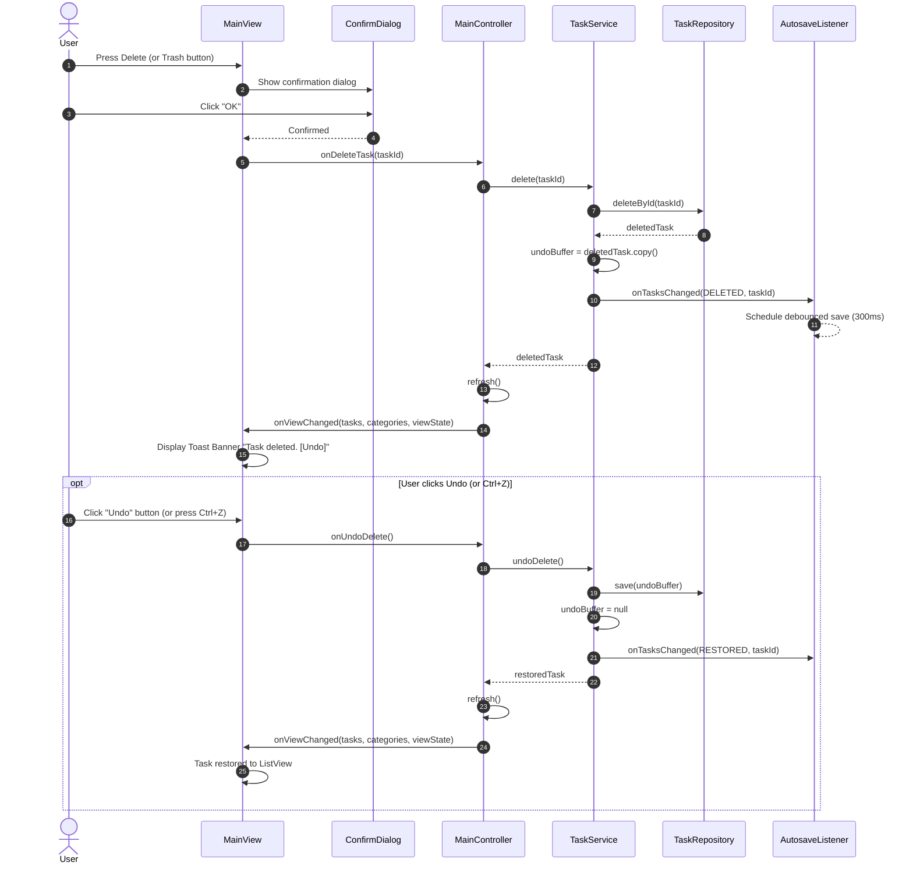

# Software Construction — Open-Ended Lab (OEL)
# Final Project Report: TODO List Desktop Application

---

## Metadata & Title Page

- **Project Title:** Modern Offline-First TODO List Desktop Application
- **Course Title:** Software Construction (CS-311 / 5th Semester)
- **Academic Term:** Fall 2026
- **Release Version:** v1.0.0
- **Release Tag:** `v1.0.0` (Git commit `6c41303`)
- **Date of Submission:** November 22, 2026
- **Author / Student Name:** [TO BE FILLED BY AUTHOR]
- **Roll Number / Student ID:** [TO BE FILLED BY AUTHOR]
- **Laboratory Instructor:** [TO BE FILLED BY AUTHOR]
- **Repository Path:** `d:\University\5th Semester\Software Construction\Lab\OEL`

---

## Screenshots Checklist (For Manual Author Insertion)

Below is the definitive inventory of screenshots required for the physical submission. When capturing screenshots, save them to the `docs/img/` directory matching these exact filenames:

| Item | Target Filename | What the Screenshot Must Show | Status / Action Needed |
|:---:|---|---|:---:|
| 1 | `docs/img/01-main-window.png` | Main application dashboard displaying top toolbar, left category sidebar with counts, task card list with sample tasks, and status bar. | `[SCREENSHOT NEEDED: Capture main window with sample tasks loaded]` |
| 2 | `docs/img/02-task-simple.png` | "New Task" dialog with `Simple` type selected, title filled, description entered, High priority, and category assigned. | `[SCREENSHOT NEEDED: Capture Simple Task creation dialog]` |
| 3 | `docs/img/03-task-checklist.png` | Task Editor with `Checklist` type selected, showing dynamic sub-item inputs, progress bar, and several checked/unchecked items. | `[SCREENSHOT NEEDED: Capture Checklist Task creation dialog]` |
| 4 | `docs/img/04-task-deadline.png` | Task Editor with `Deadline` type selected, demonstrating the JavaFX DatePicker calendar dropdown. | `[SCREENSHOT NEEDED: Capture Deadline Task dialog with DatePicker open]` |
| 5 | `docs/img/05-card-highlights.png` | Task list cards displaying visual indicators: red High priority stripe, amber Medium stripe, green Low stripe, gold Pin badge, red Overdue badge, and amber Due-Soon badge. | `[SCREENSHOT NEEDED: Capture task cards showing priority stripes, pin badge & overdue tags]` |
| 6 | `docs/img/06-category-dialog.png` | Category Management dialog showing name input field and color selection palette. | `[SCREENSHOT NEEDED: Capture Category Creation modal dialog]` |
| 7 | `docs/img/07-search-filter.png` | Main window showing an active search query in the toolbar search box, category filter applied, and filtered card results. | `[SCREENSHOT NEEDED: Capture search/filter in action with matching cards]` |
| 8 | `docs/img/08-undo-toast.png` | Bottom toast notification banner displaying `"Task '...' deleted. [Undo]"` and the menu item `Edit ▸ Undo Delete`. | `[SCREENSHOT NEEDED: Capture delete confirmation and undo toast notification banner]` |
| 9 | `docs/img/09-about-dialog.png` | "About TODO App" dialog showing version `1.0.0`, toolkit details, and authorship information (`Help ▸ About`). | `[SCREENSHOT NEEDED: Capture About dialog]` |
| 10 | `docs/img/10-shortcuts-dialog.png` | Keyboard Shortcuts reference dialog (`Help ▸ Keyboard Shortcuts`). | `[SCREENSHOT NEEDED: Capture Keyboard Shortcuts help dialog]` |

---

## Table of Contents

1. [Abstract](#1-abstract)
2. [Introduction](#2-introduction)
   - 2.1 [Background & Motivation](#21-background--motivation)
   - 2.2 [Project Objectives & Scope](#22-project-objectives--scope)
   - 2.3 [Technology Stack & Environment](#23-technology-stack--environment)
   - 2.4 [Course Outcomes & Assignment Mapping](#24-course-outcomes--assignment-mapping)
3. [Requirements Analysis](#3-requirements-analysis)
   - 3.1 [User Personas & Scenarios](#31-user-personas--scenarios)
   - 3.2 [Functional Requirements (FR-01 to FR-17)](#32-functional-requirements-fr-01-to-fr-17)
   - 3.3 [Non-Functional Requirements (NFR-01 to NFR-07)](#33-non-functional-requirements-nfr-01-to-nfr-07)
   - 3.4 [Core Use Cases & Interaction Flows](#34-core-use-cases--interaction-flows)
   - 3.5 [Scope Boundaries & Assumptions](#35-scope-boundaries--assumptions)
4. [System Architecture & Detailed Design](#4-system-architecture--detailed-design)
   - 4.1 [Architectural Overview & Layer Decoupling](#41-architectural-overview--layer-decoupling)
   - 4.2 [Package Decomposition](#42-package-decomposition)
   - 4.3 [Comprehensive Class Design](#43-comprehensive-class-design)
   - 4.4 [Data Structures & Algorithmic Rationale](#44-data-structures--algorithmic-rationale)
   - 4.5 [Persistent Storage Schema & Atomic I/O](#45-persistent-storage-schema--atomic-io)
   - 4.6 [Dynamic Behavioral Workflows (Sequence Diagrams)](#46-dynamic-behavioral-workflows-sequence-diagrams)
   - 4.7 [User Interface Layout & Wireframes](#47-user-interface-layout--wireframes)
   - 4.8 [Object-Oriented Design Patterns Applied](#48-object-oriented-design-patterns-applied)
   - 4.9 [Design Decisions & Trade-Off Analysis](#49-design-decisions--trade-off-analysis)
5. [Implementation Narrative & Code Highlights](#5-implementation-narrative--code-highlights)
6. [Object-Oriented Programming (OOP) Concepts Demonstrated](#6-object-oriented-programming-oop-concepts-demonstrated)
7. [Graphical User Interface (GUI) Walkthrough](#7-graphical-user-interface-gui-walkthrough)
8. [Testing & Quality Assurance](#8-testing--quality-assurance)
9. [Version Control with Git](#9-version-control-with-git)
10. [Evaluation Against Requirements](#10-evaluation-against-requirements)
11. [Limitations, Future Work & Conclusion](#11-limitations-future-work--conclusion)
12. [References](#12-references)
13. [Appendices](#13-appendices)

---

## 1. Abstract

This report documents the end-to-end engineering, architectural design, implementation, and quality verification of the **TODO List Desktop Application (v1.0.0)**, developed for the Software Construction Lab Open-Ended Lab (OEL). The system is a standalone, offline-first personal productivity desktop utility written in modern Java 17 and JavaFX 21, following strict object-oriented design principles, layered separation of concerns, and an automated continuous test pipeline. The application features a card-based user experience inspired by Google Keep and Microsoft To-Do, supporting polymorphic task types (Simple tasks, Checklist tasks with sub-item progress tracking, and Deadline tasks with due-date alerts), custom categories with safe reassignment, multi-criteria live filtering and sorting with a pinned-to-top invariant, and atomic JSON persistence backed by thread-safe debounced autosave. The codebase contains 54 production Java source files (6,131 lines of code) and 14 automated JUnit test suites (2,928 lines of code). Automated verification enforces a strict JaCoCo threshold of ≥80% line coverage across all non-UI packages, achieving an actual coverage of **96.63%** across 147 test cases with zero defects. The development followed a disciplined, strictly linear Git workflow across 81 Conventional Commits, culminating in the tagged `v1.0.0` release.

---

## 2. Introduction

### 2.1 Background & Motivation
Task management applications are fundamental personal computing utilities. While web and cloud-based task management solutions are prevalent, they frequently present usability drawbacks for local power users: reliance on active network connectivity, sluggish load times, vendor lock-in, and aggressive subscription models. Desktop users require a lightweight, responsive, locally resilient tool that opens instantly, saves continuously without manual intervention, and respects user data privacy through transparent local storage formats. 

From an educational perspective, developing a comprehensive desktop task management system provides an exemplary vehicle for synthesizing key concepts in software construction: domain modeling, polymorphism, interface segregation, GUI event handling, asynchronous background concurrency, fault-tolerant file persistence, unit testing, and rigorous version control.

### 2.2 Project Objectives & Scope
The primary objectives of this project were:
1. **Architectural Decoupling:** Establish a strict layered architecture (UI $\rightarrow$ Controller $\rightarrow$ Service $\rightarrow$ Repository $\rightarrow$ Storage $\rightarrow$ Model) wherein the core domain, services, and persistence layers possess zero dependencies on GUI frameworks (`javafx.*`), enabling rapid headless unit testing.
2. **Polymorphic Domain Modeling:** Implement a robust task hierarchy supporting standard to-dos, multi-item checklists with calculated completion metrics, and calendar deadlines with automated overdue detection.
3. **Ergonomic & Resilient User Interface:** Construct an aesthetically pleasing, responsive JavaFX desktop interface featuring card layouts, priority indicators, category sidebars, keyboard shortcuts, inline input validation, and undo functionality.
4. **Data Integrity & Crash Resilience:** Deliver a thread-safe persistence engine utilizing atomic temporary-file writes, automated corruption quarantine, and non-blocking debounced autosave.
5. **Quality Assurance & Traceability:** Achieve $\ge 80\%$ automated line coverage, execute comprehensive edge-case testing, and maintain full bi-directional traceability from requirements to code and test cases.

### 2.3 Technology Stack & Environment
The software was engineered, built, and verified using the following industrial-standard toolchain:
- **Programming Language:** Java Development Kit (OpenJDK 17 LTS / OpenJDK 21 LTS / OpenJDK 25)
- **Graphical Toolkit:** JavaFX (OpenJFX) 21.0.2 (Controls, Graphics, Base)
- **Build & Dependency Management:** Apache Maven 3.9.9
- **Data Serialization:** Google Gson 2.10.1 (Type discriminator mapping)
- **Automated Testing:** JUnit Jupiter 5.10.2 (JUnit 5 Platform)
- **Code Coverage:** JaCoCo Maven Plugin 0.8.11 (Threshold enforcement at package/bundle levels)
- **Version Control:** Git 2.30+ (Single-branch linear workflow on `main`)
- **Documentation & Publishing:** Pandoc 3.8.3, Markdown, KaTeX, Mermaid Diagrams

### 2.4 Course Outcomes & Assignment Mapping
This project demonstrates the student's mastery of the course objectives specified in the Software Construction syllabus:
- **CLO 2 (Design & Implementation):** Evidenced by Chapters 4, 5, 6, and 7 through detailed UML modeling, design pattern adoption (MVC, Observer, Factory, Data Mapper), and clean object-oriented implementation.
- **CLO 4 (Testing & Quality Assurance):** Evidenced by Chapters 8, 9, and 10 through 147 headless unit tests, JaCoCo code coverage verification (96.63%), static linting (`-Xlint:all`), and a structured Git repository.

The mapping between assignment tasks and report chapters is summarized below:

| Assignment Task | Focus Area | Report Chapter |
|---|---|---|
| **Task 1** | Requirements Gathering, Analysis & Specification | [Chapter 3: Requirements Analysis](#3-requirements-analysis) |
| **Task 2** | Architecture, Detailed Design & System Modeling | [Chapter 4: System Architecture & Detailed Design](#4-system-architecture--detailed-design) |
| **Task 3** | Object-Oriented Implementation & GUI Development | [Chapter 5](#5-implementation-narrative--code-highlights), [Chapter 6](#6-object-oriented-programming-oop-concepts-demonstrated) & [Chapter 7](#7-graphical-user-interface-gui-walkthrough) |
| **Task 4** | Automated Testing, Edge Cases & Verification | [Chapter 8: Testing & Quality Assurance](#8-testing--quality-assurance) |
| **Task 5** | Version Control, Git Workflow & Lifecycle Tracking | [Chapter 9: Version Control with Git](#9-version-control-with-git) |

---

## 3. Requirements Analysis

### 3.1 User Personas & Scenarios
Requirements analysis identified two core primary personas:
1. **Alex (University Student):** Manages conflicting lab deadlines, homework assignments, and club responsibilities. Requires instant task creation, visual deadline highlighting (due soon / overdue), checklist breakdowns for multifaceted projects, and high reliability so notes are never lost.
2. **Priya (Working Professional):** Needs to organize tasks by context (Work, Personal, Finance), rapidly triage priorities via keyboard shortcuts, pin critical action items to the top of the queue, and filter out noise by hiding completed items.

### 3.2 Functional Requirements (FR-01 to FR-17)
The system satisfies 17 functional requirements categorized using the MoSCoW prioritization scheme:

```
┌─────────────────────────────────────────────────────────────────────────────┐
│                       MoSCoW REQUIREMENTS SUMMARY                           │
├─────────────────────────────────────────────────────────────────────────────┤
│ MUST HAVE (Core Essentials):                                                │
│ • FR-01: Create Task (Title, description, priority, category)               │
│ • FR-02: Read / View Task Details (Summary cards, inspector dialog)         │
│ • FR-03: Update Task (In-place modification of task fields)                 │
│ • FR-04: Delete Task (Explicit removal with confirmation dialog)            │
│ • FR-05: Mark Complete / Incomplete (One-click toggle, visual strikethrough)│
│ • FR-06: Prioritize Task (High, Medium, Low with color-coded stripes)       │
│ • FR-07: Sort Tasks (Due date, priority, title, created date; pin invariant)│
│ • FR-08: Categories (Add custom categories, color badges, safe reassignment)│
│ • FR-09: Filter Tasks (Category filter, status filter, priority filter)     │
│ • FR-10: Search Tasks (Instant debounced search across title & description) │
│ • FR-13: Persistence (Local JSON storage with auto-load and atomic save)    │
│ • FR-17: Validation (Title 1-100 chars, non-blank, date rules, unique names)│
├─────────────────────────────────────────────────────────────────────────────┤
│ SHOULD HAVE (Key Differentiators):                                          │
│ • FR-11: Checklist Tasks (Sub-items with individual completion checkboxes)  │
│ • FR-12: Deadline Tasks (Due date picker, overdue and due-soon badges)      │
│ • FR-14: Pin Tasks (Anchor critical items to top regardless of active sort) │
│ • FR-15: Undo Delete (Single-step restoration via toast notification banner)│
│ • FR-16: Keyboard Shortcuts (Ctrl+N, Ctrl+F, Ctrl+Z, Space, Delete, Enter)  │
└─────────────────────────────────────────────────────────────────────────────┘
```

### 3.3 Non-Functional Requirements (NFR-01 to NFR-07)
1. **NFR-01: Usability & Ergonomics:** Modern, card-based interface styled via CSS. High visual hierarchy with color stripes for priority, clear contrast ratios, and full keyboard operability. Remembers window dimensions and position across restarts.
2. **NFR-02: Performance & Responsiveness:** UI remains 100% responsive under heavy workloads. Filtering, searching, and sorting 1,000 tasks executes in $< 100\text{ ms}$ (measured at **51 ms**).
3. **NFR-03: Reliability & Data Safety:** Zero data loss upon abrupt termination. All disk writes utilize atomic write-and-replace mechanics (`data.json.tmp` $\rightarrow$ `data.json`). Corrupt files are automatically quarantined to timestamped backups (`data.json.corrupt-<timestamp>`).
4. **NFR-04: Portability:** Cross-platform execution across 64-bit Windows, macOS, and Linux without platform-specific code. Shaded fat JAR and portable `mvn javafx:run` workflows supported.
5. **NFR-05: Maintainability & Code Cleanliness:** Strict Javadoc on all public APIs; zero warnings under `-Xlint:all`; decoupled package design with modular responsibilities.
6. **NFR-06: Testability:** Non-UI packages (`model`, `repository`, `service`, `storage`, `controller`) have zero JavaFX dependencies, enabling fast headless execution in standard JUnit test runners. Automated suite enforces $\ge 80\%$ line coverage.
7. **NFR-07: Threading & Concurrency Safety:** JavaFX Scene Graph mutations occur strictly on the JavaFX Application Thread. Disk I/O and debouncing run asynchronously off-thread via a single-threaded daemon executor. Background errors report back to the UI via `Platform.runLater`.

### 3.4 Core Use Cases & Interaction Flows
The system defines 8 detailed use cases specifying actor actions, system responses, and error flows:
- **UC-01 (Create Task):** User triggers dialog via `Ctrl+N` $\rightarrow$ enters fields $\rightarrow$ validation checks $\rightarrow$ entity constructed $\rightarrow$ repository updated $\rightarrow$ autosave scheduled $\rightarrow$ view refreshed.
- **UC-02 (View Task Details):** User double-clicks card $\rightarrow$ pre-filled modal inspector opened.
- **UC-03 (Edit Task):** User modifies attributes in place $\rightarrow$ `TaskFactory.apply` updates entity $\rightarrow$ view updates.
- **UC-04 (Delete Task with Undo):** User triggers delete $\rightarrow$ confirmation prompt $\rightarrow$ entity moved to single-slot undo buffer $\rightarrow$ toast banner displayed $\rightarrow$ user presses `Ctrl+Z` $\rightarrow$ entity restored.
- **UC-05 (Manage Categories):** User creates category with unique name and color $\rightarrow$ deletion reassigns child tasks to default `General` category.
- **UC-06 (Filter & Search):** User types query into search bar $\rightarrow$ debounced query engine filters matching items while respecting category and status constraints.
- **UC-07 (Sort with Pin Invariant):** Tasks sorted by selected criteria; pinned cards remain anchored at top.
- **UC-08 (Persistence & Recovery):** Autosave listener serializes state to disk; unreadable files are quarantined safely.

### 3.5 Scope Boundaries & Assumptions
- **In-Scope:** Single-user local desktop application, offline execution, polymorphic tasks, JSON persistence, debounced autosave, undo, search/sort, keyboard navigation.
- **Explicitly Out-of-Scope:** Multi-user concurrent networking, remote database synchronization, cloud authentication, recurring task engines, mobile native packaging.

---

## 4. System Architecture & Detailed Design

### 4.1 Architectural Overview & Layer Decoupling
The system adheres to a strict, layered architectural model where dependencies flow strictly downward. To maximize automated testability, the presentation layer (`com.todoapp.ui`) is completely decoupled from the underlying domain model, service logic, and storage mechanisms.

```
┌─────────────────────────────────────────────────────────────────────────────┐
│                              PRESENTATION TIER                              │
│  com.todoapp.ui (MainView, TaskListPane, TaskCell, AppMenuBar, Dialogs)     │
└──────────────────────────────────────┬──────────────────────────────────────┘
                                       │ Calls actions / Listens to state
┌──────────────────────────────────────▼──────────────────────────────────────┐
│                              CONTROLLER TIER                                │
│  com.todoapp.controller (MainController, ViewState, ViewListener)           │
└──────────────────────────────────────┬──────────────────────────────────────┘
                                       │ Dispatches commands
┌──────────────────────────────────────▼──────────────────────────────────────┐
│                                SERVICE TIER                                 │
│  com.todoapp.service (TaskService, CategoryService, TaskQuery, SortOption)  │
└──────────────────────────────────────┬──────────────────────────────────────┘
                                       │ Queries & mutates entities
┌──────────────────────────────────────▼──────────────────────────────────────┐
│                              REPOSITORY TIER                                │
│  com.todoapp.repository (TaskRepository, CategoryRepository, In-Memory)     │
└──────────────────────────────────────┬──────────────────────────────────────┘
                                       │ Loaded from / Saved to
┌──────────────────────────────────────▼──────────────────────────────────────┐
│                               STORAGE TIER                                  │
│  com.todoapp.storage (Storage, JsonStorage, JsonMapper, AutosaveListener)   │
└──────────────────────────────────────┬──────────────────────────────────────┘
                                       │ Operates upon
┌──────────────────────────────────────▼──────────────────────────────────────┐
│                                DOMAIN MODEL                                 │
│  com.todoapp.model (Task hierarchy, Category, Priority, TaskDraft, Factory) │
└─────────────────────────────────────────────────────────────────────────────┘
```

#### Architectural Invariants
1. **Headless Domain Core:** Under no circumstances may any class inside `model`, `repository`, `service`, `storage`, or `controller` import any class from `javafx.*`. This rule ensures all business logic executes in standard, headless JUnit runners within milliseconds.
2. **Defensive Immutability Boundary:** To protect entity encapsulation, `TaskService` returns deep copies of `Task` objects to external callers via `Task.copy()`. External consumers cannot mutate stored repository references directly; updates must be submitted via validated `TaskDraft` records.
3. **Thread Confinement:** All JavaFX Scene Graph mutations, dialog displays, and CSS updates occur exclusively on the JavaFX Application Thread. Disk I/O executes asynchronously on a background daemon executor thread, marshaling completion/error callbacks back via `Platform.runLater`.

### 4.2 Package Decomposition
The application is structured into 6 focused packages under `com.todoapp`:

```
com.todoapp/
├── App.java                     # JavaFX bootstrap, dependency injection & lifecycle
├── AppConfig.java               # Immutable CLI & system properties record parser
├── DevSeed.java                 # Sample data generator for development testing
├── Launcher.java                # Non-Application launcher for shaded JAR compatibility
│
├── model/                       # Domain entities, records, and factories
│   ├── Task.java                # Abstract root entity with core attributes
│   ├── SimpleTask.java          # Standard to-do task implementation
│   ├── ChecklistTask.java       # Multi-item task with progress ratio calculation
│   ├── ChecklistItem.java       # Individual checklist sub-item entity
│   ├── DeadlineTask.java        # Calendar deadline task with overdue logic
│   ├── Category.java            # Categorization entity with hex color codes
│   ├── Priority.java            # Enumeration: HIGH (Red), MEDIUM (Amber), LOW (Green)
│   ├── TaskType.java            # Enumeration: SIMPLE, CHECKLIST, DEADLINE
│   ├── TaskDraft.java           # Immutable value record for creation & update inputs
│   └── TaskFactory.java         # Centralized instantiation and draft application factory
│
├── repository/                  # Storage-agnostic repository interfaces & implementations
│   ├── TaskRepository.java      # Task CRUD & query abstraction
│   ├── CategoryRepository.java  # Category CRUD & name lookup abstraction
│   ├── InMemoryTaskRepository.java     # LinkedHashMap-backed task repository
│   └── InMemoryCategoryRepository.java # LinkedHashMap-backed category repository
│
├── service/                     # Business logic, query engine, and domain events
│   ├── TaskService.java         # Task lifecycle, sorting, priority, pin, undo buffer
│   ├── CategoryService.java     # Category rules, validation, deletion reassignment
│   ├── TaskQuery.java           # Immutable multi-criteria query record
│   ├── SortOption.java          # Sorting strategy: DUE_DATE, PRIORITY, TITLE, CREATED
│   ├── StatusFilter.java        # Status filtering strategy: ALL, ACTIVE, COMPLETED
│   ├── TaskChangeListener.java  # Observer callback for repository mutations
│   ├── ChangeType.java          # Event types: CREATED, UPDATED, DELETED, RESTORED
│   ├── ValidationException.java  # Domain validation failure exception
│   └── NotFoundException.java   # Entity lookup failure exception
│
├── storage/                     # Persistence abstraction, atomic file I/O & autosave
│   ├── Storage.java             # Persistence contract: load() and save()
│   ├── JsonStorage.java         # Atomic file I/O with corruption quarantine
│   ├── JsonMapper.java          # Gson polymorphic mapping with type discriminator
│   ├── AppData.java             # Immutable root container record (categories, tasks)
│   ├── DataSync.java            # Repository-to-AppData snapshot & population utility
│   ├── AutosaveListener.java    # Debounced background executor for persistent autosave
│   └── StorageException.java    # File read/write failure runtime exception
│
├── controller/                  # Presentation orchestration & UI state management
│   ├── MainController.java      # Dispatches UI gestures to services, coordinates state
│   ├── ViewState.java           # Immutable snapshot of UI state (query, selection, messages)
│   └── ViewListener.java        # Observer contract for notifying views of state changes
│
└── ui/                          # JavaFX controls, custom cells, dialogs & styling
    ├── MainView.java            # Root BorderPane view composing all UI panels
    ├── AppMenuBar.java          # Top menu bar (File, Edit, View, Help) with shortcuts
    ├── ToolbarPane.java         # Search bar, "+ New Task" button, sort & status filters
    ├── CategoryPane.java        # Left sidebar listing categories with count badges
    ├── TaskListPane.java        # Center ListView hosting custom task cells
    ├── TaskCell.java            # Polymorphic ListCell rendering cards with stripes & badges
    ├── TaskEditorDialog.java    # Modal dialog for creating and editing tasks
    ├── CategoryDialog.java      # Modal dialog for creating custom categories
    ├── StatusBar.java           # Bottom bar showing task counts and autosave status
    └── Theme.java               # Design tokens, palette constants, and stylesheet bindings
```

### 4.3 Comprehensive Class Design
The system's structural design is captured in the UML class diagram below:

```mermaid
classDiagram
    direction TB

    %% Model Layer
    class Task {
        <<abstract>>
        -UUID id
        -String title
        -String description
        -Priority priority
        -UUID categoryId
        -boolean completed
        -boolean pinned
        -LocalDateTime createdAt
        -LocalDateTime updatedAt
        +getId() UUID
        +getTitle() String
        +setTitle(String)
        +getDescription() String
        +setDescription(String)
        +getPriority() Priority
        +setPriority(Priority)
        +getCategoryId() UUID
        +setCategoryId(UUID)
        +isCompleted() boolean
        +setCompleted(boolean)
        +isPinned() boolean
        +setPinned(boolean)
        +getCreatedAt() LocalDateTime
        +getUpdatedAt() LocalDateTime
        +touch()
        +getType()* TaskType
        +getSummary()* String
        +getProgress()* double
        +getDueDate()* Optional~LocalDate~
        +isOverdue(LocalDate)* boolean
        +copy()* Task
    }

    class SimpleTask {
        +getType() TaskType
        +getSummary() String
        +getProgress() double
        +getDueDate() Optional~LocalDate~
        +isOverdue(LocalDate) boolean
        +copy() SimpleTask
    }

    class ChecklistTask {
        -List~ChecklistItem~ items
        +getItems() List~ChecklistItem~
        +addItem(String) ChecklistItem
        +removeItem(UUID) boolean
        +toggleItem(UUID) boolean
        +getType() TaskType
        +getSummary() String
        +getProgress() double
        +getDueDate() Optional~LocalDate~
        +isOverdue(LocalDate) boolean
        +copy() ChecklistTask
    }

    class ChecklistItem {
        -UUID id
        -String text
        -boolean completed
        +getId() UUID
        +getText() String
        +setText(String)
        +isCompleted() boolean
        +setCompleted(boolean)
        +copy() ChecklistItem
    }

    class DeadlineTask {
        -LocalDate dueDate
        +getDueDate() Optional~LocalDate~
        +setDueDate(LocalDate)
        +isOverdue(LocalDate) boolean
        +getType() TaskType
        +getSummary() String
        +getProgress() double
        +copy() DeadlineTask
    }

    class Category {
        -UUID id
        -String name
        -String colorHex
        +getId() UUID
        +getName() String
        +setName(String)
        +getColorHex() String
        +setColorHex(String)
        +copy() Category
    }

    class Priority {
        <<enumeration>>
        HIGH
        MEDIUM
        LOW
    }

    class TaskType {
        <<enumeration>>
        SIMPLE
        CHECKLIST
        DEADLINE
    }

    class TaskDraft {
        <<record>>
        +TaskType type
        +String title
        +String description
        +Priority priority
        +UUID categoryId
        +LocalDate dueDate
        +List~String~ checklistItems
        +validate()
    }

    class TaskFactory {
        +static create(TaskDraft) Task
        +static create(TaskDraft, LocalDateTime) Task
        +static apply(Task, TaskDraft)
        +static apply(Task, TaskDraft, LocalDateTime)
    }

    Task <|-- SimpleTask
    Task <|-- ChecklistTask
    Task <|-- DeadlineTask
    ChecklistTask "1" *-- "0..*" ChecklistItem
    Task --> Priority
    Task --> TaskType
    Task ..> Category : references categoryId
    TaskFactory ..> Task : creates/modifies
    TaskFactory ..> TaskDraft : consumes

    %% Repository Layer
    class TaskRepository {
        <<interface>>
        +findAll() List~Task~
        +findById(UUID) Optional~Task~
        +save(Task) Task
        +deleteById(UUID) Optional~Task~
        +clear()
        +count() int
    }

    class InMemoryTaskRepository {
        -Map~UUID, Task~ tasks
        +findAll() List~Task~
        +findById(UUID) Optional~Task~
        +save(Task) Task
        +deleteById(UUID) Optional~Task~
        +clear()
        +count() int
    }

    class CategoryRepository {
        <<interface>>
        +findAll() List~Category~
        +findById(UUID) Optional~Category~
        +findByNameIgnoreCase(String) Optional~Category~
        +save(Category) Category
        +deleteById(UUID) Optional~Category~
        +clear()
        +count() int
    }

    class InMemoryCategoryRepository {
        -Map~UUID, Category~ categories
        +findAll() List~Category~
        +findById(UUID) Optional~Category~
        +findByNameIgnoreCase(String) Optional~Category~
        +save(Category) Category
        +deleteById(UUID) Optional~Category~
        +clear()
        +count() int
    }

    TaskRepository <|.. InMemoryTaskRepository
    CategoryRepository <|.. InMemoryCategoryRepository

    %% Service Layer
    class TaskService {
        -TaskRepository taskRepo
        -CategoryRepository categoryRepo
        -Clock clock
        -List~TaskChangeListener~ listeners
        -Task undoBuffer
        +create(TaskDraft) Task
        +update(UUID, TaskDraft) Task
        +delete(UUID) Task
        +undoDelete() Optional~Task~
        +get(UUID) Task
        +getAll() List~Task~
        +toggleComplete(UUID) Task
        +setPriority(UUID, Priority) Task
        +togglePinned(UUID) Task
        +query(TaskQuery) List~Task~
        +countByPriority(TaskQuery) Map~Priority, Integer~
        +countActive() int
        +countCompleted() int
        +addListener(TaskChangeListener)
    }

    class CategoryService {
        -CategoryRepository categoryRepo
        -TaskRepository taskRepo
        -Clock clock
        -List~TaskChangeListener~ listeners
        +create(String, String) Category
        +rename(UUID, String) Category
        +recolor(UUID, String) Category
        +delete(UUID) Category
        +getAll() List~Category~
        +get(UUID) Category
        +countTasks(UUID) int
        +addListener(TaskChangeListener)
    }

    class TaskChangeListener {
        <<interface>>
        +onTasksChanged(ChangeType, UUID)
    }

    class TaskQuery {
        <<record>>
        +UUID categoryId
        +StatusFilter status
        +Priority priority
        +String searchText
        +SortOption sort
        +boolean ascending
        +withCategory(UUID) TaskQuery
        +withStatus(StatusFilter) TaskQuery
        +withPriority(Priority) TaskQuery
        +withSearch(String) TaskQuery
        +withSort(SortOption, boolean) TaskQuery
    }

    TaskService --> TaskRepository
    TaskService --> CategoryRepository
    TaskService ..> TaskChangeListener : notifies
    CategoryService --> CategoryRepository
    CategoryService --> TaskRepository
    CategoryService ..> TaskChangeListener : notifies
    TaskService ..> TaskQuery : filters with

    %% Storage Layer
    class Storage {
        <<interface>>
        +load() AppData
        +save(AppData)
    }

    class JsonStorage {
        -Path filePath
        -Clock clock
        -String lastLoadWarning
        +load() AppData
        +save(AppData)
        +getLastLoadWarning() Optional~String~
    }

    class AppData {
        <<record>>
        +int schemaVersion
        +List~Category~ categories
        +List~Task~ tasks
    }

    class JsonMapper {
        +static toJson(AppData) JsonObject
        +static fromJson(JsonObject) AppData
        +static taskToJson(Task) JsonObject
        +static taskFromJson(JsonObject) Task
    }

    class DataSync {
        +static populateRepositories(AppData, TaskRepository, CategoryRepository)
        +static snapshot(TaskRepository, CategoryRepository) AppData
    }

    class AutosaveListener {
        -Storage storage
        -TaskRepository taskRepo
        -CategoryRepository categoryRepo
        -ScheduledExecutorService executor
        -Consumer~String~ errorCallback
        +onTasksChanged(ChangeType, UUID)
        +flush()
        +close()
    }

    Storage <|.. JsonStorage
    AutosaveListener ..|> TaskChangeListener
    JsonStorage ..> JsonMapper : uses
    JsonStorage ..> AppData : reads/writes
    DataSync ..> AppData : converts

    %% Controller Layer
    class MainController {
        -TaskService taskService
        -CategoryService categoryService
        -ViewState currentState
        -List~ViewListener~ viewListeners
        +onCreateTask(TaskDraft)
        +onUpdateTask(UUID, TaskDraft)
        +onDeleteTask(UUID)
        +onUndoDelete()
        +onToggleComplete(UUID)
        +onSetPriority(UUID, Priority)
        +onTogglePinned(UUID)
        +onSelectCategory(UUID)
        +onSearch(String)
        +onSort(SortOption, boolean)
        +onStatusFilter(StatusFilter)
        +onPriorityFilter(Priority)
        +onCreateCategory(String, String)
        +onRenameCategory(UUID, String)
        +onRecolorCategory(UUID, String)
        +onDeleteCategory(UUID)
        +refresh()
        +addListener(ViewListener)
    }

    class ViewState {
        <<record>>
        +TaskQuery query
        +UUID selectedTaskId
        +String infoMessage
        +String errorMessage
    }

    class ViewListener {
        <<interface>>
        +onViewChanged(List~Task~, List~Category~, ViewState)
    }

    MainController --> TaskService
    MainController --> CategoryService
    MainController ..> ViewListener : notifies
    MainController *-- ViewState

    %% UI Layer
    class MainView {
        -MainController controller
        -AppMenuBar menuBar
        -ToolbarPane toolbar
        -CategoryPane categoryPane
        -TaskListPane taskListPane
        -StatusBar statusBar
        +onViewChanged(List~Task~, List~Category~, ViewState)
    }

    class TaskCell {
        +updateItem(Task, boolean)
    }

    class TaskEditorDialog {
        +showAndWait() Optional~TaskDraft~
    }

    class AppMenuBar {
        -MenuItem undoMenuItem
        -CheckMenuItem showCompletedItem
        +updateState(ViewState, boolean)
        +static showAboutDialog()
        +static showShortcutsDialog()
    }

    class CategoryDialog {
        +showAndWait() Optional~CategoryDraft~
    }

    MainView ..|> ViewListener
    MainView --> MainController
    MainView *-- TaskCell
    MainView *-- AppMenuBar
    MainView ..> TaskEditorDialog : presents
    MainView ..> CategoryDialog : presents
```



### 4.4 Data Structures & Algorithmic Rationale
Every data structure in the application was selected to optimize performance, memory efficiency, and algorithmic invariants:

| Data Structure | Layer & Location | Concrete Rationale & Complexity Analysis |
|---|---|---|
| `LinkedHashMap<UUID, Task>` | `InMemoryTaskRepository` | Provides $\mathcal{O}(1)$ average-time complexity for lookups, insertions, and deletions by `UUID` primary key. Unlike standard `HashMap`, it preserves deterministic insertion order, ensuring reproducible test output and predictable JSON serialization. |
| `LinkedHashMap<UUID, Category>` | `InMemoryCategoryRepository` | Ensures $\mathcal{O}(1)$ key-based access while guaranteeing the default category (`General`) remains permanently first in iteration order. |
| `ArrayList<ChecklistItem>` | `ChecklistTask` | Optimal for small, ordered sequences of checklist sub-items. Contiguous memory allocation minimizes memory overhead, and index-based access is $\mathcal{O}(1)$. Typical checklist sizes rarely exceed 50 items. |
| `EnumMap<Priority, Integer>` | `TaskService.countByPriority` | Uses an internal compact array indexed directly by the `Priority` enum ordinal. Guarantees zero hashing collisions, zero resize rehashes, and negligible memory footprint during status-bar aggregation. |
| Composite `Comparator<Task>` Chain | `TaskService.query` | Functional comparator composition: `Comparator.comparing(Task::isPinned).reversed().thenComparing(...)`. Executes in $\mathcal{O}(N \log N)$ time, permanently anchoring pinned tasks at the top across all sort selections and providing deterministic tie-breaking via `createdAt`. |

### 4.5 Persistent Storage Schema & Atomic I/O
The application stores all tasks, categories, and metadata in a single, human-readable JSON document located at `~/.todoapp/data.json`.

#### Polymorphic JSON Schema Example
```json
{
  "schemaVersion": 1,
  "categories": [
    {
      "id": "00000000-0000-0000-0000-000000000001",
      "name": "General",
      "colorHex": "#1976D2"
    },
    {
      "id": "e4b10b83-a212-4c26-88d4-5394ef3f7521",
      "name": "Academics",
      "colorHex": "#388E3C"
    }
  ],
  "tasks": [
    {
      "type": "SIMPLE",
      "id": "b3e04771-419b-4a81-a67b-11c5040081d2",
      "title": "Review Software Construction lecture slides",
      "description": "Focus on Layered Architecture and MVC patterns.",
      "priority": "HIGH",
      "categoryId": "e4b10b83-a212-4c26-88d4-5394ef3f7521",
      "completed": false,
      "pinned": true,
      "createdAt": "2026-11-22T09:00:00",
      "updatedAt": "2026-11-22T09:15:00"
    },
    {
      "type": "CHECKLIST",
      "id": "c8a4128f-7c15-46a2-9721-e09214b76c89",
      "title": "Complete Open-Ended Lab Deliverables",
      "description": "Milestones M00 through M14.",
      "priority": "HIGH",
      "categoryId": "e4b10b83-a212-4c26-88d4-5394ef3f7521",
      "completed": false,
      "pinned": false,
      "createdAt": "2026-11-22T09:30:00",
      "updatedAt": "2026-11-22T10:00:00",
      "items": [
        {
          "id": "11111111-1111-1111-1111-111111111111",
          "text": "M11: UI Extras & Polish",
          "completed": true
        },
        {
          "id": "22222222-2222-2222-2222-222222222222",
          "text": "M12: Testing & Hardening",
          "completed": true
        },
        {
          "id": "33333333-3333-3333-3333-333333333333",
          "text": "M13: Packaging & Release",
          "completed": true
        },
        {
          "id": "44444444-4444-4444-4444-444444444444",
          "text": "M14: Final Project Report",
          "completed": false
        }
      ]
    },
    {
      "type": "DEADLINE",
      "id": "f5e92711-236b-4e12-859a-112345678901",
      "title": "Submit Final OEL Report & Code",
      "description": "Upload zipped artifact and commit log.",
      "priority": "HIGH",
      "categoryId": "e4b10b83-a212-4c26-88d4-5394ef3f7521",
      "completed": false,
      "pinned": true,
      "createdAt": "2026-11-22T10:00:00",
      "updatedAt": "2026-11-22T10:00:00",
      "dueDate": "2026-11-23"
    }
  ]
}
```

#### Atomic Persistence Mechanics
To guarantee NFR-03 (Reliability & Crash Resilience), `JsonStorage.java` performs file writes using a two-stage atomic replace:
1. The serialized JSON string is written to a temporary sibling file: `~/.todoapp/data.json.tmp`.
2. The file is flushed and closed to ensure all byte buffers are physically committed to storage.
3. `Files.move(tempPath, targetPath, StandardCopyOption.ATOMIC_MOVE, StandardCopyOption.REPLACE_EXISTING)` executes the atomic filesystem inode replacement.
4. If a crash, power outage, or OS kill occurs at any point during writing, the original `data.json` remains completely intact and uncorrupted.
5. If the target file contains malformed or unreadable JSON during startup, the application immediately isolates the corrupted file by renaming it to `data.json.corrupt-<timestamp>` and initializes a clean state with default categories, preventing catastrophic crashes.

### 4.6 Dynamic Behavioral Workflows (Sequence Diagrams)

#### 4.6.1 Task Creation Workflow


#### 4.6.2 Task Deletion & Undo Workflow


### 4.7 User Interface Layout & Wireframes
The user interface layout is organized around a primary root `BorderPane`:

```
+----------------------------------------------------------------------------------------------------+
|  File   Edit   View   Help                                                             (AppMenuBar)|
+----------------------------------------------------------------------------------------------------+
| [+ New Task]   [🔍 Search tasks...]     [Filter: All/Active v]   [Sort: Due Date v]  (ToolbarPane) |
+-----------------------------------+----------------------------------------------------------------+
| CATEGORIES         (CategoryPane) | TASKS                                           (TaskListPane) |
| • All Tasks                  (12) | +------------------------------------------------------------+ |
| • General                     (3) | | [ ] 📌 Finish Lab Report                      [Work] [High]| |
| • Work                        (4) | |     Complete all milestones and export PDF.                | |
| • Personal                    (3) | |     Due: Tomorrow • 4/5 items (80%) [====    ]             | |
| • Shopping                    (2) | +------------------------------------------------------------+ |
|                                   | +------------------------------------------------------------+ |
|                                   | | [X] Buy groceries                         [Shopping] [Med] | |
|                                   | |     Milk, Bread, Bananas                                   | |
| [+ Add Category]                  | +------------------------------------------------------------+ |
+-----------------------------------+----------------------------------------------------------------+
| Ready • 12 tasks (8 active, 4 completed) • Autosaved                             (StatusBar)       |
+----------------------------------------------------------------------------------------------------+
```

### 4.8 Object-Oriented Design Patterns Applied
The software architecture incorporates five established design patterns:
1. **Model-View-Controller (MVC):** `MainView` acts as View, capturing user input and presenting state; `MainController` acts as Controller, coordinating actions and updating `ViewState`; `TaskService` and domain entities act as Model.
2. **Factory Method:** `TaskFactory.java` encapsulates the creation and modification of polymorphic `Task` subtypes (`SimpleTask`, `ChecklistTask`, `DeadlineTask`), abstracting instantiation logic from callers.
3. **Observer Pattern:** Implemented via two distinct event channels: `TaskChangeListener` enables repositories and services to publish mutation events to `AutosaveListener`; `ViewListener` allows `MainController` to broadcast updated `ViewState` snapshots to `MainView`.
4. **Data Mapper Pattern:** `JsonMapper.java` decouples domain entities from physical storage formatting, using explicit `"type"` discriminator properties to map bidirectional transformations between entities and Gson `JsonObject` trees.
5. **Strategy / Functional Comparators:** `SortOption.java` and `TaskQuery.java` encapsulate dynamic sorting algorithms (`Comparator<Task>`), allowing runtime selection of sort strategies without modifying the querying engine.

### 4.9 Design Decisions & Trade-Off Analysis

| Architectural Decision | Chosen Alternative | Alternatives Considered | Concrete Rationale & Trade-Off Analysis |
|---|---|---|---|
| **GUI Framework** | **JavaFX 21 (LTS)** | Java Swing, SWT, JavaFX 17 | JavaFX 21 provides a modern scene-graph architecture, high-DPI font rendering, CSS styling, observable property bindings, and high-level controls (`ListView`, `DatePicker`, `Dialog`). Retrieved via Maven Central without requiring local SDK installations. |
| **GUI Construction Style** | **Programmatic Java Code** | FXML + `FXMLLoader` | Building views programmatically in Java keeps the compilation fast and lightweight, eliminates runtime reflection overhead, provides complete compile-time type safety, and produces clean Git diffs during version control. |
| **Persistence Format** | **Atomic JSON (Gson)** | SQLite / H2, Native Java Serialization | JSON offers human readability, instant debugging, zero platform-specific C-library dependencies, and effortless multi-platform portability. Atomic write-and-replace prevents file corruption. |
| **Entity Immutability** | **Defensive Copying via `Task.copy()`** | Shared mutable references, Read-only proxy wrappers | Service methods return deep copies of stored domain entities. This strictly prevents UI components from bypassing domain validation by directly mutating in-memory repository references. |
| **Git Workflow** | **Single Linear Branch on `main`** | GitFlow, Feature Branches with Pull Requests | Tailored for solo developer efficiency. Eliminates merge commits, avoids branch synchronization overhead, and guarantees a completely linear, bisectable, and auditable Git history. |
| **Launcher Separation** | **Distinct `Launcher` Entry Class** | Direct launch from `App extends Application` | JavaFX requires that executable shaded fat JARs do not have a main class extending `Application`, or the JVM throws `Missing JavaFX runtime components`. The separate `Launcher.java` resolves this cleanly. |
| **Autosave Strategy** | **Debounced Background Executor (300 ms)** | Immediate synchronous save, Periodic fixed timer | Immediate synchronous saves would block the UI thread during rapid keystrokes; fixed periodic timers risk losing up to the period duration of edits on crash. A 300 ms debounce triggers persistence immediately after typing stops while maintaining zero UI lag. |
