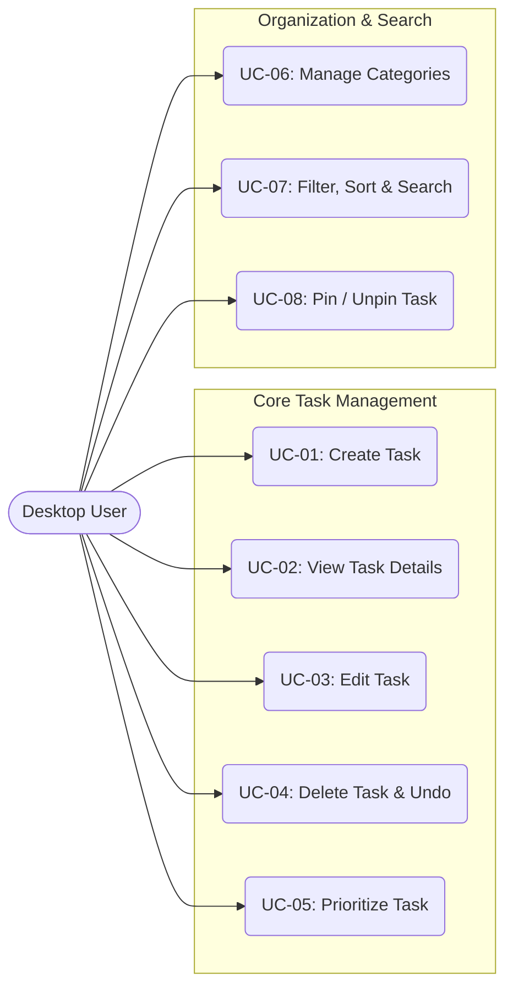

# Software Requirements Specification (SRS)
## TODO List Desktop Application

> **Project:** Simple TODO list desktop application (Google Keep / Microsoft Notes style) in Java 17 and JavaFX 21.  
> **Course / Context:** Software Construction — Lab Open-Ended Lab (OEL)  
> **Assignment Task Mapping:** Task 1 (Define requirements and features) · **CLO:** CLO 2 (Analyze and specify software requirements).

---

## 1. Purpose & Scope

### 1.1 Purpose
The purpose of this document is to specify the functional and non-functional requirements for the TODO List Desktop Application. The application is a single-user personal task manager inspired by lightweight, fluid desktop note-taking applications (such as Google Keep and Microsoft OneNote/Sticky Notes). It emphasizes clear object-oriented design, responsive desktop interaction via JavaFX, robust input validation, and automatic local data persistence.

### 1.2 In-Scope Capabilities
- **Task Lifecycle (CRUD):** Creating, viewing, editing, completing, and deleting tasks.
- **Polymorphic Task Types:** Support for Simple tasks (basic notes), Checklist tasks (sub-items with completion tracking), and Deadline tasks (due-date tracking with overdue and due-soon badges).
- **Task Prioritization:** Clear High, Medium, and Low priorities with visual indicator stripes and quick-action updates.
- **Categorization:** Color-coded categories with a guaranteed default "General" category and safe cascade handling upon deletion.
- **Organization & Retrieval:** Multi-criteria filtering (category, status, priority), multi-attribute sorting (priority, due date, creation date, title), and live keyword search.
- **Pinned Tasks:** Anchoring critical tasks at the top of the list regardless of the active sorting criterion.
- **Safety & Usability:** Delete confirmation dialogues, single-slot undo buffer, validation error feedback, and standard keyboard shortcuts.
- **Storage:** Local atomic JSON persistence with background debounced autosave.

### 1.3 Out-of-Scope (v1.0 Release)
The following capabilities are deliberately excluded from version 1.0:
- Cloud synchronization and multi-device accounts.
- Multi-user authentication, access control, and collaboration.
- Operating-system level background push notifications and audible alarms.
- Recurring or repeating task schedules (daily, weekly, custom intervals).
- Rich-text formatting (bold, italic, markdown inside text bodies) or image attachments.
- Mobile, web, or browser-based companion clients.
- Drag-and-drop manual card reordering.

---

## 2. Stakeholders & User Personas

| Stakeholder / Persona | Role & Background | Core Needs & Frustrations |
|---|---|---|
| **Sarah Chen** (Undergraduate Student) | Third-year computer science student balancing coursework, lab assignments, and group projects. | Needs fast, distraction-free capture of assignment deadlines and sub-task checklists; frustrated by heavy cloud productivity tools that require accounts or lag when offline. |
| **Marcus Vance** (Consultant / Software Engineer) | Freelance technical consultant managing multiple client engagements, deliverables, and personal goals. | Needs quick prioritization (High/Medium/Low), categorization per client project, instant search, and keyboard shortcuts to manage daily todos without interrupting development workflows. |

---

## 3. Glossary

- **Task:** The fundamental domain entity representing an actionable item with an immutable UUID, title, description, category reference, priority, completion flag, pin flag, and timestamps.
- **Simple Task:** A standard task subclass containing basic textual title and detailed notes.
- **Checklist Task:** A specialized task subclass containing an ordered collection of checklist sub-items, dynamically calculating completion percentage and summary ratios.
- **ChecklistItem:** An individual actionable sub-item within a checklist task with its own completion state.
- **Deadline Task:** A specialized task subclass associated with a specific calendar due date, evaluating whether it is overdue or due soon.
- **Category:** An organizational tag defined by a unique name and color code (`#RRGGBB`).
- **General Category:** The fixed, permanent default category (`Category.DEFAULT_ID`) that cannot be deleted or renamed.
- **Priority:** An urgency level (`HIGH`, `MEDIUM`, `LOW`) with assigned numeric ranks and distinct visual colors.
- **Pinned Task:** A task flagged with `pinned = true`, forcing it to display at the top of any queried or sorted list.
- **Autosave:** A debounced background process that automatically flushes dirty application state to persistent storage without user intervention.
- **Undo Buffer:** An ephemeral single-item restore slot enabling instant recovery of the most recently deleted task.

---

## 4. Use-Case Overview

---

## 5. User Stories

Each user story directly maps to a functional requirement (`FR-01` through `FR-17`):

- **US-01 (FR-01):** As a student, I want to create tasks with a title, optional description, priority, category, and task type, so that I can systematically record my coursework and obligations.
- **US-02 (FR-02):** As a user, I want to view all tasks in an organized list and open any task to inspect its details, so that I maintain clear visibility over my commitments.
- **US-03 (FR-03):** As a professional, I want to update editable fields of existing tasks, so that I can keep task details aligned with changing project specifications.
- **US-04 (FR-04):** As a user, I want a confirmation prompt before deleting a task, so that I avoid losing notes due to inadvertent clicks or keypresses.
- **US-05 (FR-05):** As a user, I want to toggle task completion status with a single click, so that marking work complete is immediate and satisfying.
- **US-06 (FR-06):** As a consultant, I want to designate tasks as High, Medium, or Low priority with distinct visual colors and fast list updates, so that critical tasks immediately stand out.
- **US-07 (FR-07):** As a student, I want to sort tasks by priority, due date, creation date, or title, while keeping pinned tasks anchored on top, so that I can arrange my workload logically.
- **US-08 (FR-08):** As a user, I want to create, rename, recolor, and delete categories, with tasks of deleted categories automatically moving to "General", so that organizing tasks never risks orphan data.
- **US-09 (FR-09):** As a professional, I want to filter tasks by category, status (All, Active, Completed), and priority, so that I can eliminate noise and focus on what needs action right now.
- **US-10 (FR-10):** As a user, I want real-time live keyword search across titles and descriptions, so that I can retrieve relevant tasks in milliseconds.
- **US-11 (FR-11):** As a student, I want checklist tasks where I can add, toggle, and delete sub-items while observing overall progress ratios, so that I can execute multi-step assignments methodically.
- **US-12 (FR-12):** As a professional, I want deadline tasks with due dates and visual overdue/due-soon alerts, so that I deliver client milestones on schedule.
- **US-13 (FR-13):** As a user, I want my tasks, categories, and settings automatically saved and restored on startup, so that I never lose work when closing or restarting the app.
- **US-14 (FR-14):** As a user, I want to pin vital tasks to the top of the list, so that key reminders remain front and center regardless of active sorting.
- **US-15 (FR-15):** As a user, I want an undo mechanism after deleting a task, so that I can immediately reverse an accidental deletion without data loss.
- **US-16 (FR-16):** As a power user, I want keyboard shortcuts for new task, delete, search focus, undo, and completion toggle, so that I can operate the app efficiently without reaching for the mouse.
- **US-17 (FR-17):** As a user, I want clear, inline validation messages whenever input violates constraints, so that I understand exactly what to adjust before saving.

---

## 6. Functional Requirements

The following requirements represent the canonical functional specifications for the system. Priority is defined according to the MoSCoW framework: **M**ust have, **S**hould have, **C**ould have.

| ID | Requirement | Pri |
|---|---|---|
| FR-01 | **Create** a task: required title (1–100 chars), optional description (≤2000 chars), priority, category, task type | M |
| FR-02 | **Read**: see all tasks in a list; open a task to view all its details | M |
| FR-03 | **Update** any editable field of an existing task | M |
| FR-04 | **Delete** a task, with a confirmation prompt | M |
| FR-05 | Mark a task complete / incomplete with one click | M |
| FR-06 | **Prioritize**: High / Medium / Low; change priority quickly from the list; visible colored indicator | M |
| FR-07 | **Sort** by priority, due date, creation date, or title (ascending/descending); pinned tasks always first | M |
| FR-08 | **Categories**: create, rename, delete, recolor; a non-deletable default category ("General"); deleting a category moves its tasks to General | M |
| FR-09 | **Filter** by category, status (all/active/completed) and priority | M |
| FR-10 | **Search** tasks by text in title/description (case-insensitive, live) | S |
| FR-11 | **Checklist tasks**: a task containing items that can be checked off; shows progress (e.g. 2/5) | S |
| FR-12 | **Deadline tasks**: due date; overdue and due-soon highlighting | S |
| FR-13 | **Persistence**: all data is saved automatically and restored on next launch | M |
| FR-14 | **Pin** a task to keep it at the top | S |
| FR-15 | **Undo** the last delete (until app closes or another delete happens) | C |
| FR-16 | Keyboard shortcuts (new task, delete, search focus, toggle complete) | C |
| FR-17 | **Validation**: clear user-facing messages for invalid input (blank title, over-length, duplicate category name, missing due date) | M |

### 6.1 Detailed Functional Specifications

#### FR-01: Task Creation
- The user can select the task type: Simple, Checklist, or Deadline.
- The title is mandatory, trimmed of leading/trailing whitespace, and must be between 1 and 100 characters.
- The description is optional, up to 2000 characters (stored as an empty string if null).
- Priority defaults to `MEDIUM` if unspecified.
- Category defaults to the default category (`General`) if unspecified.
- An immutable UUID is assigned upon creation, along with initial timestamps for `createdAt` and `updatedAt`.

#### FR-02: Task Reading & Inspection
- All tasks are rendered in a scrollable list view.
- Each task displays its title, priority stripe/badge, category chip, pin status, and polymorphic summary.
- Double-clicking or selecting a task opens the full task inspection and editing view.

#### FR-03: Task Updating
- All editable attributes (title, description, priority, category, deadline date, checklist items) may be modified.
- The polymorphic `TaskType` cannot be altered after creation in v1.0.
- Any modification automatically refreshes `updatedAt`.

#### FR-04: Task Deletion
- Initiating deletion opens a modal confirmation dialog displaying the task title.
- Confirming removes the task from the repository and places it into the single-slot undo buffer.
- Canceling the dialog aborts the deletion without altering any state.

#### FR-05: Task Completion
- A checkbox on the task card allows immediate toggling between completed and active.
- For Simple and Deadline tasks, completion marks the task complete and applies strikethrough styling.
- For Checklist tasks, toggling task completion marks all sub-items complete; checking the final incomplete sub-item auto-completes the task; unchecking any sub-item marks the task incomplete.

#### FR-06: Task Prioritization
- Supported priorities: `HIGH` (Rank 1, Red), `MEDIUM` (Rank 2, Amber), `LOW` (Rank 3, Green).
- Priority can be updated via the editor dialog or quickly via the right-click context menu.
- Each task card features a prominent colored indicator corresponding to its priority.

#### FR-07: Sorting
- Supports sorting by: Priority, Due Date (tasks without due dates positioned last regardless of order), Creation Date, or Title (case-insensitive alphabetical).
- Ascending and descending directions are supported for all criteria.
- **Pinned invariant:** Pinned tasks are always sorted to the top before unpinned tasks, with secondary sorting adhering to the chosen criterion and `createdAt` as the tiebreaker.

#### FR-08: Category Management
- Users can create custom categories with a name (1–30 characters, unique case-insensitively) and hex color code (`#RRGGBB`).
- Categories can be renamed and recolored.
- A permanent default category ("General") with fixed ID `Category.DEFAULT_ID` is always present and cannot be deleted or renamed.
- When a user deletes a category, all associated tasks are automatically reassigned to the "General" category.

#### FR-09: Multi-Dimensional Filtering
- The user can filter simultaneously by:
  - Selected Category (or "All Categories")
  - Completion Status (`ALL`, `ACTIVE`, `COMPLETED`)
  - Priority (`ANY`, `HIGH`, `MEDIUM`, `LOW`)
- Only tasks matching all active filter predicates are displayed in the list view.

#### FR-10: Live Keyword Search
- An interactive search field filters tasks dynamically as the user types (case-insensitive substring match).
- The search query checks both the task title and description.
- A clear button ("✕") resets the search query instantly.

#### FR-11: Checklist Tasks
- Tasks can contain an arbitrary number of sub-items (text 1–100 characters each).
- The task summary dynamically renders a progress ratio (e.g., "2/5 done") and a graphical progress bar.
- Individual sub-items can be checked or unchecked independently.

#### FR-12: Deadline Tasks
- Associates a calendar due date (`LocalDate`) with the task.
- Displays a formatted deadline summary (e.g., "Due Fri, 20 Nov").
- Visual highlighting marks tasks as overdue (due date prior to current date and incomplete) or due soon (within 2 days).

#### FR-13: Automatic Local Persistence
- The application automatically persists categories and tasks to a local JSON file (`~/.todoapp/data.json` or custom path).
- Changes are debounced (~300 ms) to prevent excessive disk I/O while guaranteeing data integrity.
- Data writes are atomic (using temporary files and atomic replace) to prevent corruption during unexpected shutdowns.

#### FR-14: Task Pinning
- Any task can be pinned or unpinned via the card pin icon or context menu.
- Pinned tasks display a visual pin icon, distinct card background styling, and stay grouped at the top of the list.

#### FR-15: Undo Last Deletion
- A single-slot undo buffer preserves the most recently deleted task.
- The user can restore the deleted task via the Edit menu, keyboard shortcut (`Ctrl+Z`), or a temporary status bar action.
- The restored task retains its original UUID, timestamps, fields, and checklist items.
- The buffer is cleared once restored or when replaced by a subsequent deletion.

#### FR-16: Keyboard Shortcuts
- `Ctrl+N`: Create new task.
- `Enter` / `F2`: Edit selected task.
- `Delete`: Delete selected task.
- `Ctrl+F`: Focus search input.
- `Space`: Toggle completion of selected task.
- `Ctrl+Z`: Undo last deleted task.

#### FR-17: Comprehensive Input Validation
- Blank titles or titles exceeding 100 characters produce immediate feedback.
- Descriptions exceeding 2000 characters are rejected.
- Duplicate category names (case-insensitive) are rejected.
- Deadline tasks without a selected due date are rejected.
- Validation failures keep input dialogs open without losing user-entered text.

---

## 7. Non-Functional Requirements

The non-functional requirements define the architectural qualities, operational constraints, and quality gates for the application.

| ID | Requirement |
|---|---|
| NFR-01 | **Usability:** core actions reachable in ≤2 clicks; no unexplained errors; empty states have helpful text |
| NFR-02 | **Performance:** UI refresh with 1,000 tasks < 200 ms; startup < 2 s |
| NFR-03 | **Reliability:** no data loss on crash during save (atomic write); corrupt data file never crashes the app |
| NFR-04 | **Portability:** runs on Windows, macOS, Linux with JDK 17+ (JavaFX is fetched by Maven; the shaded JAR is built per operating system, `mvn javafx:run` works everywhere) |
| NFR-05 | **Maintainability:** layered design (model / repository / service / controller / ui); Javadoc on all public types and methods |
| NFR-06 | **Testability:** model, repository, service, storage and controller layers have no JavaFX dependency; ≥80% line coverage there |
| NFR-07 | **Threading:** all scene-graph access on the JavaFX Application Thread; no blocking I/O on that thread during rendering; background work reports back via `Platform.runLater` |

### 7.1 Detailed Non-Functional Specifications

#### NFR-01: Usability & Ergonomics
- Common user workflows (creating a task, marking complete, filtering by category, changing priority) require at most two clicks or a single keyboard shortcut.
- When no tasks exist or no tasks match current search/filter criteria, clean empty state placeholders guide the user ("No tasks yet — click New Task" or "No tasks match your filters").
- User error messages are descriptive and actionable, avoiding raw exception names or technical jargon.

#### NFR-02: Performance & Scalability
- UI updates, sorting, and filtering on data sets of up to 1,000 tasks complete within 200 milliseconds.
- Cold application startup to fully interactive main view takes less than 2.0 seconds on standard desktop hardware.
- Memory consumption remains lightweight (nominal heap < 120 MB).

#### NFR-03: Reliability & Fault Tolerance
- File writes use a write-to-temporary-file and atomic move pattern (`ATOMIC_MOVE`, `REPLACE_EXISTING`) to prevent partial or corrupted file states during sudden power loss or process termination.
- If the data file is unreadable or syntactically corrupt, the app renames the corrupt file to `data.json.corrupt-<timestamp>`, initializes an empty state with default categories, alerts the user, and continues running safely without crashing.

#### NFR-04: Portability & Environment Independence
- Targets standard Java 17 LTS and JavaFX 21 LTS across Windows, macOS, and Linux.
- Builds and runs completely from the command line using Apache Maven without requiring a specific IDE.
- Shaded runnable JAR packaging supports self-contained execution without separate JavaFX SDK installations.

#### NFR-05: Maintainability & Code Quality
- Strict architectural layering: `ui` -> `controller` -> `service` -> `repository` -> `storage` -> `model`. Dependencies point downward only.
- Strict Javadoc documentation on all public classes, interfaces, methods, and constants; compiler and javadoc tool produce zero warnings on public APIs.
- Code conforms to standard Java conventions (UTF-8, LF, 4-space indentation, no magic strings/numbers).

#### NFR-06: Testability & Quality Assurance
- Domain model, repositories, services, storage layer, and controller classes have zero dependencies on `javafx.*` packages, enabling fast headless execution in standard JUnit test runners.
- Automated unit test suite enforces ≥ 80% line coverage across non-UI packages (`model`, `repository`, `service`, `storage`, `controller`) verified via JaCoCo.

#### NFR-07: Threading & Concurrency Safety
- All JavaFX Scene Graph mutations, dialog displays, and UI control updates execute strictly on the JavaFX Application Thread.
- Heavy file I/O operations (such as disk serialization) run off the UI thread via a single-threaded background autosave executor.
- Background error and completion notifications report back to the UI thread using `javafx.application.Platform.runLater`.
