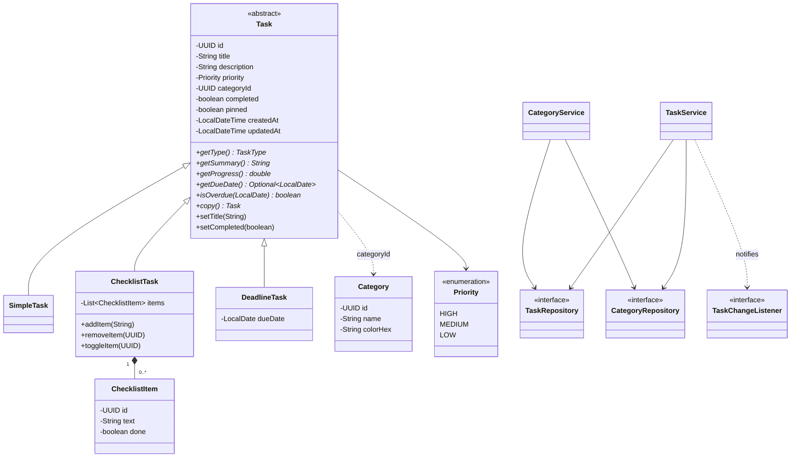

.kkkkkkkko# TODO List Desktop App — Implementation Plan

> **Project:** Simple TODO list desktop application (Google Keep / Microsoft Notes style) in Java, built with object-oriented design (classes, objects, inheritance, polymorphism), a **JavaFX** GUI, and Git version control.
> **How to use this file:** tell an AI agent `Execute M03` (or `Execute M08.2`) and it must follow Section 0 exactly. Everything the agent needs is in this file.
> **Revision:** GUI toolkit is JavaFX; all work happens directly on `main` (no milestone branches); a final report milestone (M14) is included. See the Decision Log (Section 9).

---

## Table of Contents

0. [Agent Execution Protocol](#0-agent-execution-protocol)
1. [Project Overview & Course Mapping](#1-project-overview--course-mapping)
2. [Technology Decisions](#2-technology-decisions)
3. [Requirements (canonical list)](#3-requirements-canonical-list)
4. [Architecture & Design](#4-architecture--design)
5. [Git Workflow & Conventions](#5-git-workflow--conventions)
6. [Coding Standards & Quality Gates](#6-coding-standards--quality-gates)
7. [Milestones](#7-milestones)
8. [Progress Tracker](#8-progress-tracker)
9. [Decision Log](#9-decision-log)
10. [Appendix: Prompt Cheat-Sheet](#10-appendix-prompt-cheat-sheet)

---

## 0. Agent Execution Protocol

When the user says **`Execute Mxx`** (a milestone) or **`Execute Mxx.y`** (a sub-milestone), do the following, in order. Do not skip steps.

1. **Read first.** Read Sections 1–6 of this file and the target milestone in Section 7. Do not read ahead and do not do work belonging to other milestones.
2. **Check prerequisites.**
   - Every milestone listed under *Depends on* must be marked ✅ in the Progress Tracker (Section 8). If not, stop and tell the user which one is missing.
   - `git status` must be clean and the current branch must be `main` (M00 creates the repo, so it is exempt). If the tree is dirty, stop and ask.
   - Run `java -version` and `mvn -v` once; Java must be 17+.
3. **Stay on `main`.** Do **not** create branches, pull requests or merge commits. All commits go straight onto `main`, keeping the history linear (Section 5).
4. **Do the steps in order.** Make the commits listed under *Commits* at the points indicated — small, focused, Conventional Commit messages (Section 5). If you discover a necessary extra commit (e.g. a fix), add it with a proper message. Every commit should leave the project building; never leave `main` broken at the end of your work.
5. **Verify.** Run every command in *Verify* and confirm every item in *Acceptance criteria*. The build (`mvn -q verify`) must pass before the milestone is marked done. If something cannot be verified in your environment (e.g. no display for the JavaFX GUI), say so explicitly and list the manual checks for the human — never claim success for something you did not check.
6. **Update the Progress Tracker** (Section 8): set the status to ✅ and the date (🟡 if only a sub-milestone was done). Commit it as `docs: mark M## complete`.
7. **Tag.** If the milestone lists a tag, create it on the final commit (annotated: `git tag -a vX.Y.Z -m "..."`). Push only if a remote is configured **and** the user asked for it.
8. **Report** to the user in at most ~10 lines: what was built, the commits made, verification results, deviations from the plan (also add them to the Decision Log), and any manual checks left.

**Rules**
- Do not change decisions in Sections 2–4 silently. If a change is truly needed, make it, and record it in the Decision Log with a reason.
- Do not add libraries beyond those listed in Section 2 without logging it in the Decision Log.
- If a milestone is blocked or ambiguous, stop and ask rather than guess.
- Never commit build output (`target/`), IDE files, or personal data files.
- Sub-milestones (`M09.2`) may be executed alone, in order; the parent milestone is only ✅ when all its sub-milestones are done.
- Never invent facts, numbers, screenshots or results (this matters most for docs and the final report): measure them or mark them clearly as pending for the human.

---

## 1. Project Overview & Course Mapping

**Goal:** a desktop app where a user can create, view, edit, delete and prioritize tasks, group them into categories, and have them saved between sessions. The codebase must clearly demonstrate OOP: encapsulation, abstraction, inheritance, polymorphism, interfaces, and composition.

| Assignment task | CLO | Where it is delivered |
|---|---|---|
| 1. Define requirements & features (CRUD + prioritize) | CLO 2 | Section 3, `docs/requirements.md` — **M01** |
| 2. Plan/design architecture, classes, methods, data structures | CLO 2 | Section 4, `docs/design.md` — **M02** |
| 3. Create IDE project, dependencies; implement Task/Category/app classes and add/edit/delete/prioritize | CLO 4 | **M00**, **M03–M07** |
| 4. GUI (JavaFX) with buttons, text fields, lists for tasks and categories | CLO 4 | **M08–M11** |
| 5. Git version control | CLO 4 | Section 5, applied in every milestone; history reviewed in **M13** and analysed in **M14** |
| Final detailed project report (added) | CLO 2, CLO 4 | `docs/report.md` — **M14** |

---

## 2. Technology Decisions

| Concern | Decision | Reason |
|---|---|---|
| Language | Java 17 (LTS) | Records, enums, `java.time`, widely available |
| Build | Maven 3.9+ | Standard; works from the terminal, so it is IDE-independent (VS Code is the chosen IDE) |
| GUI | **JavaFX 21 (LTS)** via Maven (`org.openjfx:javafx-controls:21.0.2`) | Required by the project owner. Modern scene-graph UI, CSS styling, `ListView`/`Dialog`/`DatePicker` built in. Not bundled with the JDK, so it comes from Maven Central (no separate SDK install). JavaFX 21 supports JDK 17+ |
| Running the GUI | `org.openjfx:javafx-maven-plugin:0.0.8` → `mvn javafx:run` | Sets up the JavaFX module path automatically |
| Modules | **No `module-info.java`** (classpath project) | Keeps Gson/JUnit/shade simple; JavaFX is added to the module path by the plugin |
| Styling | One stylesheet `src/main/resources/com/todoapp/ui/styles.css` + a `Theme` constants class | Keep colors/spacing in one place; no inline style strings scattered around |
| Persistence | JSON file via **Gson 2.10.1** | Human-readable; manual tree mapping handles polymorphic tasks |
| Tests | JUnit Jupiter 5.10.x (only) | Standard; no mocking framework needed (use hand-written fakes). No TestFX: UI is kept thin and checked with a manual script |
| Coverage | JaCoCo (Maven plugin) | Verify coverage of `model`, `service`, `repository`, `storage`, `controller` |
| Packaging | `maven-shade-plugin` → runnable JAR whose `Main-Class` is `com.todoapp.Launcher` | JavaFX refuses to start from a fat JAR whose main class extends `Application`; the plain `Launcher` class avoids that |
| IDE | **Visual Studio Code** with the *Extension Pack for Java* (includes *Language Support for Java*, *Debugger for Java*, *Test Runner for Java*, *Maven for Java*, *Project Manager for Java*) | The assignment says "an IDE such as Eclipse or IntelliJ"; VS Code is the project owner's choice. Every build/run/test step is still a Maven command run in the VS Code integrated terminal, so no step depends on IDE features. No IDE-specific files are committed |
| VCS | Git, **single branch `main`**, linear history, Conventional Commits, annotated tags | Simple solo workflow |

- **Group ID / base package:** `com.todoapp` · **Artifact:** `todo-app` · **Main class (IDE / `javafx:run`):** `com.todoapp.App` · **JAR entry point:** `com.todoapp.Launcher`
- **Data file:** `${user.home}/.todoapp/data.json`, overridable with program argument `--data=<path>` or system property `-Dtodoapp.data=<path>` (tests always override).
- **Dev seed:** program argument `--seed` or `-Dtodoapp.seed=true` (see M08).
- **Run during development:** `mvn javafx:run` (pass arguments with `-Djavafx.args="--seed --data=/tmp/todo-dev.json"`).

---

## 3. Requirements (canonical list)

Priority uses MoSCoW: **M**ust, **S**hould, **C**ould.

### 3.1 Functional requirements

| ID | Requirement | Pri |
|---|---|---|
| FR-01 | **Create** a task: required title (1–100 chars), optional description (≤2000 chars), priority, category, task type | M |
| FR-02 | **Read**: see all tasks in a list; open a task to view all its details | M |
| FR-03 | **Update** any editable field of an existing task | M |
| FR-04 | **Delete** a task, with a confirmation prompt | M |
| FR-05 | Mark a task complete / incomplete with one click | M |
| FR-06 | **Prioritize**: High / Medium / Low; change priority quickly from the list; visible colored indicator | M |
| FR-07 | **Sort** by priority, due date, creation date, or title (ascending/descending); pinned tasks always first | M |
| FR-08 | **Categories**: create, rename, delete, recolor; a non-deletable default category ("General"); deleting a category moves its tasks to General | M |
| FR-09 | **Filter** by category, status (all/active/completed) and priority | M |
| FR-10 | **Search** tasks by text in title/description (case-insensitive, live) | S |
| FR-11 | **Checklist tasks**: a task containing items that can be checked off; shows progress (e.g. 2/5) | S |
| FR-12 | **Deadline tasks**: due date; overdue and due-soon highlighting | S |
| FR-13 | **Persistence**: all data is saved automatically and restored on next launch | M |
| FR-14 | **Pin** a task to keep it at the top | S |
| FR-15 | **Undo** the last delete (until app closes or another delete happens) | C |
| FR-16 | Keyboard shortcuts (new task, delete, search focus, toggle complete) | C |
| FR-17 | **Validation**: clear user-facing messages for invalid input (blank title, over-length, duplicate category name, missing due date) | M |

### 3.2 Non-functional requirements

| ID | Requirement |
|---|---|
| NFR-01 | **Usability:** core actions reachable in ≤2 clicks; no unexplained errors; empty states have helpful text |
| NFR-02 | **Performance:** UI refresh with 1,000 tasks < 200 ms; startup < 2 s |
| NFR-03 | **Reliability:** no data loss on crash during save (atomic write); corrupt data file never crashes the app |
| NFR-04 | **Portability:** runs on Windows, macOS, Linux with JDK 17+ (JavaFX is fetched by Maven; the shaded JAR is built per operating system, `mvn javafx:run` works everywhere) |
| NFR-05 | **Maintainability:** layered design (model / repository / service / controller / ui); Javadoc on all public types and methods |
| NFR-06 | **Testability:** model, repository, service, storage and controller layers have no JavaFX dependency; ≥80% line coverage there |
| NFR-07 | **Threading:** all scene-graph access on the JavaFX Application Thread; no blocking I/O on that thread during rendering; background work reports back via `Platform.runLater` |

### 3.3 Out of scope (v1.0)

Cloud sync, multi-user accounts, reminders/notifications, recurring tasks, rich-text or image notes, mobile version, drag-and-drop reordering.

---

## 4. Architecture & Design

### 4.1 Layers

```
ui (JavaFX views, dialogs, cells, CSS)      ← no business rules
   │ calls / listens
controller (MainController, UI state)       ← translates UI events to service calls
   │
service (TaskService, CategoryService)      ← business rules, validation, change events
   │
repository (TaskRepository, CategoryRepository, in-memory) ← data structures
   │
storage (Storage, JsonStorage, mappers)     ← file I/O, JSON mapping
model (Task hierarchy, Category, enums)     ← plain domain objects (used by all layers)
```

Dependencies point downward only. Nothing outside `ui`, `App` and `Launcher` may import `javafx.*`.

### 4.2 Package layout

```
todo-app/
├── pom.xml
├── README.md
├── implementation.md
├── .gitignore
├── docs/
│   ├── requirements.md      (M01)
│   ├── design.md            (M02, updated at M13)
│   ├── test-plan.md         (M12)
│   ├── user-guide.md        (M13)
│   ├── course-mapping.md    (M13)
│   ├── report.md            (M14)
│   ├── report-evidence/     (M14: raw measurements the report cites)
│   └── img/                 (screenshots and rendered diagrams)
└── src/
    ├── main/java/com/todoapp/
    │   ├── Launcher.java    (plain main class: calls Application.launch(App.class, args))
    │   ├── App.java         (extends javafx.application.Application)
    │   ├── AppConfig.java   (parses --data / --seed and system properties; no JavaFX)
    │   ├── model/       Priority, TaskType, Task, SimpleTask, ChecklistTask, ChecklistItem,
    │   │                DeadlineTask, Category, TaskDraft, TaskFactory
    │   ├── repository/  TaskRepository, CategoryRepository,
    │   │                InMemoryTaskRepository, InMemoryCategoryRepository
    │   ├── service/     TaskService, CategoryService, TaskQuery, SortOption, StatusFilter,
    │   │                TaskChangeListener, ValidationException, NotFoundException
    │   ├── storage/     Storage, AppData, JsonStorage, JsonMapper, AutosaveListener
    │   ├── controller/  MainController, ViewState, ViewListener
    │   └── ui/          MainView, ToolbarPane, CategoryPane, TaskListPane, TaskCell,
    │                    TaskEditorDialog, CategoryDialog, StatusBar, Theme
    ├── main/resources/com/todoapp/ui/styles.css
    └── test/java/com/todoapp/   (mirrors main packages)
```

### 4.3 Class design (core)



**Model rules**
- `Task` (abstract): `id` (UUID, immutable), `title` (1–100, trimmed), `description` (≤2000, may be empty, never null), `priority` (default MEDIUM), `categoryId`, `completed`, `pinned`, `createdAt` (immutable), `updatedAt` (auto-touched by every setter). `equals`/`hashCode` by `id`. Setters validate and throw `IllegalArgumentException`.
- **Polymorphic members (abstract in `Task`):**

| Method | SimpleTask | ChecklistTask | DeadlineTask |
|---|---|---|---|
| `getType()` | SIMPLE | CHECKLIST | DEADLINE |
| `getSummary()` | first ~80 chars of description (or "") | "2/5 done" | "Due Fri, 20 Nov" (+ "overdue") |
| `getProgress()` | 0.0 or 1.0 | doneItems/totalItems (1.0 if no items and completed) | 0.0 or 1.0 |
| `getDueDate()` | empty | empty | `Optional.of(dueDate)` |
| `isOverdue(today)` | false | false | `!completed && dueDate.isBefore(today)` |
| `copy()` | deep copy, same id | deep copy incl. items, same id | copy, same id |

- `ChecklistTask`: completing the task marks all items done; checking the last item auto-completes the task; unchecking any item un-completes it. Items have ≤100 chars text.
- `Category`: `id`, `name` (1–30 chars, unique case-insensitively), `colorHex` (`#RRGGBB`). The default category uses the fixed id `Category.DEFAULT_ID = UUID.nameUUIDFromBytes("default-category".getBytes())`, name "General", and cannot be deleted (it may be recolored, not renamed).
- `Priority` enum: `HIGH(1,"High")`, `MEDIUM(2,"Medium")`, `LOW(3,"Low")` with `getRank()`, `getLabel()`, `fromLabel(String)`.
- `TaskDraft` (immutable record): `type, title, description, priority, categoryId, dueDate (nullable), checklistItems (List<String>)`. Used for create and update so the UI never builds domain objects directly.
- `TaskFactory`: `static Task create(TaskDraft)` (Factory pattern; switch on `TaskType`) and `static void apply(Task existing, TaskDraft)` (update in place; type cannot change in v1.0 — attempting it throws `ValidationException`).

**Service layer**
- `TaskService(TaskRepository, CategoryRepository, Clock)`:
  `create(TaskDraft) → Task`, `update(UUID, TaskDraft) → Task`, `delete(UUID) → Task`, `restore(Task)` (for undo), `get(UUID)`, `getAll()`, `toggleComplete(UUID)`, `setPriority(UUID, Priority)`, `togglePinned(UUID)`, `query(TaskQuery) → List<Task>`, `addListener(TaskChangeListener)`.
  Returns **copies** of tasks to callers (`Task.copy()`) so UI code cannot mutate repository state.
- `CategoryService(CategoryRepository, TaskRepository)`: `create(name, color)`, `rename(id, name)`, `recolor(id, color)`, `delete(id)` (reassigns tasks to General), `getAll()`, `countTasks(id)`.
- `TaskQuery` (immutable record, with `with…` helpers): `categoryId (nullable = all)`, `StatusFilter status` (ALL/ACTIVE/COMPLETED), `Priority priority (nullable = any)`, `String searchText`, `SortOption sort`, `boolean ascending`.
- `SortOption` enum, each constant supplies a `Comparator<Task>`: `PRIORITY`, `DUE_DATE` (tasks without date last), `CREATED`, `TITLE`. The service always wraps the chosen comparator so **pinned tasks come first**, with `createdAt` as the final tiebreaker for stable ordering.
- `TaskChangeListener` (Observer): `void onTasksChanged(ChangeType type, UUID taskId)`; `ChangeType` = CREATED, UPDATED, DELETED, RESTORED, CATEGORY_CHANGED. Used by UI refresh and autosave.
- Exceptions: `ValidationException` (user-fixable input problem; message is shown in the UI), `NotFoundException`.

**Data structures (and why)**
- `LinkedHashMap<UUID, Task>` in `InMemoryTaskRepository` — O(1) lookup by id, stable insertion order.
- `LinkedHashMap<UUID, Category>` in `InMemoryCategoryRepository` — same reason; default category is always present.
- `ArrayList<ChecklistItem>` inside `ChecklistTask` — ordered, small.
- `EnumMap<Priority, Integer>` for per-priority counts (status bar/stats).
- `Comparator` chains and `Predicate<Task>` composition for sorting/filtering.
- `ArrayDeque<Task>` (size 1) or single `Task` field for the undo buffer.
- `ObservableList<Task>` (JavaFX, UI layer only) backing the `ListView`; replaced via `setAll` on every refresh.

**Storage layer**
- `Storage` interface: `AppData load() throws StorageException`, `void save(AppData data) throws StorageException`.
- `AppData` record: `int schemaVersion, List<Category> categories, List<Task> tasks`.
- `JsonStorage(Path file)`: saves atomically (write `data.json.tmp`, then `Files.move(..., ATOMIC_MOVE, REPLACE_EXISTING)`, falling back to a normal replace if atomic move is unsupported). Missing file → empty `AppData` with the default category. Corrupt/unreadable file → rename it to `data.json.corrupt-<yyyyMMddHHmmss>`, return empty data, and expose a `lastLoadWarning` message that the UI shows once.
- `JsonMapper`: hand-written `Task ↔ JsonObject` mapping using a `"type"` discriminator (`SIMPLE|CHECKLIST|DEADLINE`) — this is the polymorphic (de)serialization. Dates in ISO-8601. Unknown `type` → skip that task and add a warning (never crash). Schema version field starts at `1`.
- `AutosaveListener implements TaskChangeListener`: on any change, saves a snapshot, debounced by ~300 ms using a plain single-thread `ScheduledExecutorService` (no JavaFX types), flushed on shutdown. Save failures are reported through a `Consumer<String>` callback (the UI wraps it in `Platform.runLater` to show it in the status bar), never thrown to the user thread.

**Controller / UI (JavaFX)**
- `ViewState` (immutable): current `TaskQuery`, selected task id, last error/info message.
- `MainController` (plain Java, **no JavaFX imports**): owns the `TaskQuery`; exposes `onCreateTask`, `onUpdateTask`, `onDeleteTask(id)`, `onToggleComplete(id)`, `onSetPriority(id, p)`, `onSelectCategory(id)`, `onSearch(text)`, `onSort(opt, asc)`, etc.; calls services; publishes refreshed `List<Task>` + `ViewState` to registered `ViewListener`s; catches `ValidationException` and routes the message to the UI.
- `App extends Application`: `start(Stage)` builds the object graph (storage → repositories → services → autosave → controller), creates `MainView`, shows the `Stage`; `stop()` flushes autosave.
- `MainView` layout (`BorderPane` inside a `Scene` that loads `styles.css`): **top** `ToolbarPane` (New Task button, search `TextField`, sort `ComboBox` + direction `ToggleButton`, status filter, priority filter) · **left** `CategoryPane` (`ListView` with counts + add/rename/delete buttons) · **center** `TaskListPane` (`ListView<Task>` with `TaskCell` cell factory; `setPlaceholder` for empty states) · **bottom** `StatusBar` (counts, messages, Undo button).
- `TaskCell extends ListCell<Task>` draws each task as a "card": priority color stripe, completion `CheckBox`, title (strikethrough if complete), pin icon, category chip, and `task.getSummary()` / `ProgressBar` — it calls the **polymorphic** methods only, never `instanceof`. The node graph is built once in the constructor; `updateItem` only updates text/styles.
- `TaskEditorDialog extends Dialog<TaskDraft>` (modal, used for both Create and Edit): fields = type selector (disabled when editing), title `TextField`, description `TextArea`, priority `ComboBox`, category `ComboBox`; a `StackPane` whose children are toggled with `visible`/`managed` switches between *Simple* (nothing extra), *Checklist* (item `ListView` with add/remove) and *Deadline* (`DatePicker`). OK/Cancel `ButtonType`s; an inline error `Label` shows validation messages, and the OK button's `ActionEvent` is consumed on failure so the dialog stays open.
- Threading: everything in `ui`/`controller` runs on the **JavaFX Application Thread**; services are fast and in-memory so they are called there too; only disk writes happen off-thread (autosave executor), and any callback from that thread to the UI goes through `Platform.runLater`.

### 4.4 OOP concepts demonstrated (for the course report)

| Concept | Where |
|---|---|
| Encapsulation | Private fields + validating setters in `Task`, `Category`; services return copies |
| Abstraction | Abstract `Task`; interfaces `TaskRepository`, `Storage`, `TaskChangeListener` |
| Inheritance | `SimpleTask`, `ChecklistTask`, `DeadlineTask` extend `Task`; `TaskCell extends ListCell<Task>`; `App extends Application` |
| Polymorphism | `getSummary/getProgress/isOverdue/copy` overridden; cell and mapper treat all tasks uniformly; `SortOption` comparators |
| Composition | `ChecklistTask` has `ChecklistItem`s; services compose repositories |
| Interfaces / DI | Services receive repositories via constructors (easy test fakes) |
| Design patterns | Factory (`TaskFactory`), Observer (`TaskChangeListener`, `ViewListener`), Strategy (`SortOption`), MVC (model / ui / controller) |
| Exceptions | Custom checked/unchecked exceptions for validation and storage |

---

## 5. Git Workflow & Conventions

- **Branching:** a single branch, `main`. No feature/milestone branches, no pull requests, no merge commits, no rebasing or rewriting of existing history. The history stays linear. `main` must build after every milestone (and ideally after every commit).
- **Commit messages** — Conventional Commits, imperative mood, ≤72 chars subject:
  `feat(model): add Task abstract class`, `test(service): cover category deletion`, `docs: add requirements document`, `chore: configure maven shade plugin`, `fix(storage): handle empty data file`, `refactor(ui): extract Theme colors`.
  Allowed types: `feat, fix, docs, test, refactor, chore, build, style`.
- **Commit size:** one logical change per commit; tests for a feature go in the same or the immediately following commit.
- **Never commit:** `target/`, `.idea/`, `*.iml`, `.classpath`, `.project`, `.settings/`, `.vscode/`, `out/`, `*.log`, user data files, OS junk (`.DS_Store`).
- **Tags (annotated), made on `main`:** `v0.1.0` after M07 (core + persistence), `v0.2.0` after M09 (CRUD GUI), `v0.3.0` after M10 (categories & organize), `v1.0.0` after M13.
- **Collaboration (assignment item 5):** the default is a solo workflow. If teammates join, everyone commits small changes to `main` and runs `git pull --rebase` before pushing (this only replays *unpushed* local commits, so published history is never rewritten). `README.md` documents this (written in M00, polished in M13).
- **Bug fixes outside a milestone** (`Fix: <problem>`): a `fix(scope):` commit that includes a regression test, directly on `main`.

---

## 6. Coding Standards & Quality Gates

- Java 17, 4-space indentation, UTF-8, LF endings, line length ≤ 110, one top-level type per file.
- Naming: `PascalCase` classes, `camelCase` methods/fields, `UPPER_SNAKE` constants; packages lowercase.
- **Javadoc** on every public class, interface, method, and constant (class summary + `@param/@return/@throws` where non-obvious). The `maven-javadoc-plugin` or `mvn javadoc:javadoc` must run without errors (warnings for missing docs on public API count as failures).
- No `System.out.println` in production code (use `java.util.logging`; the only exception is the one-line start-up failure message in `Launcher`, printed to `System.err`); no empty `catch` blocks; no `null` returns from collections (return empty); prefer `Optional` for "maybe" results.
- No magic numbers/strings for limits: constants in `Task`/`Category` (`MAX_TITLE_LENGTH = 100`, etc.).
- **JavaFX rules:** build UI in code (no FXML, to keep the project dependency-light and diff-friendly); styles live in `styles.css` and `Theme` constants, not scattered inline `setStyle` strings (dynamic per-item colors such as category chips are the only allowed `setStyle` use); never touch a `Node` off the Application Thread.
- **Quality gates for every milestone:** `mvn -q verify` passes; new code has tests (model/service/storage/controller); no TODO/FIXME left in committed code (unless listed in the Decision Log); formatted consistently.
- UI code is verified by compiling + manual checklist (`docs/test-plan.md`); logic that can be tested without JavaFX must live in `controller`, `service` or `model`.

---

## 7. Milestones

Effort estimates are for one developer (hours). All milestones are done on `main` (Section 0, step 3).

### M00 — Repository & project scaffolding · ~1.5 h
**Goal:** a Git-tracked Maven + JavaFX project that builds, tests, runs from the terminal, and opens cleanly in VS Code.
**Depends on:** nothing.

**Steps**
1. Verify `java -version` (17+), `mvn -v`, `git --version`. If Maven is missing, tell the user how to install it and stop.
2. Create the project directory (if the user did not give one, use `todo-app/`), `git init -b main`, set nothing global in git config.
3. Create `.gitignore` (see Section 5 list), `.editorconfig` (UTF-8, LF, 4 spaces), and a skeleton `README.md` (title, one-paragraph description, build/run placeholders, link to `implementation.md`, "Contributing" section describing the main-only workflow and commit conventions from Section 5). Copy this plan into the repo root as `implementation.md` if it is not already there.
4. Create `pom.xml`: `groupId com.todoapp`, `artifactId todo-app`, `version 0.1.0-SNAPSHOT`, `maven.compiler.release 17`, UTF-8; dependencies `org.openjfx:javafx-controls:21.0.2`, `com.google.code.gson:gson:2.10.1`, and `org.junit.jupiter:junit-jupiter:5.10.2` (test scope); plugins: `maven-compiler-plugin`, `maven-surefire-plugin 3.2.5`, `jacoco-maven-plugin` (report at `verify`, no threshold yet), `org.openjfx:javafx-maven-plugin:0.0.8` (`mainClass` = `com.todoapp.App`), `maven-jar-plugin` with `Main-Class com.todoapp.Launcher`. (Shade plugin is added in M13.)
5. Create the package directories from Section 4.2 with `package-info.java` files (Javadoc describing each package's role), and the resources folder `src/main/resources/com/todoapp/ui/` with an empty-for-now `styles.css`.
6. Create `App.java` (`extends Application`, `APP_NAME = "TODO App"`): `start(Stage)` shows an empty `Stage` titled "TODO App" (800×600, centered, with a `Scene` that loads `styles.css`). Create `Launcher.java` with `main` that calls `Application.launch(App.class, args)`; if the JavaFX toolkit cannot start (no display), catch the failure, print a one-line message to `System.err`, and exit with code 1 instead of a stack trace.
7. Add a trivial smoke test (`AppSmokeTest`) asserting `App.APP_NAME` equals "TODO App" (it must not start the toolkit), so the test pipeline is proven.
8. Create `docs/` with a `.gitkeep`.

**Acceptance criteria**
- `mvn -q verify` succeeds; `mvn javafx:run` opens a blank window titled "TODO App" (or, with no display, exits gracefully with a clear message).
- `git status` clean; `git log` shows the commits below; `target/` is not tracked; `git branch` lists only `main`.
- README lists: prerequisites (JDK 17+, Maven), `mvn verify`, `mvn javafx:run`, how to open the project in VS Code (File ▸ Open Folder on the project root; install the "Extension Pack for Java"; the Java Projects view detects `pom.xml`; run the app with `mvn javafx:run` in the integrated terminal rather than the editor's Run button, because JavaFX needs the Maven plugin's module-path setup; run tests from the Testing view or `mvn test`; for rendering the Mermaid diagrams in `docs/`, install a Markdown Mermaid preview extension).

**Verify:** `mvn -q verify`, `git status --short` (empty), `git ls-files | grep -c target` → 0, `git branch --list` → only `main`.

**Commits**
1. `chore: initialize repository with gitignore and editorconfig`
2. `build: add maven project with javafx, gson and junit`
3. `feat: add JavaFX application entry point with empty window`
4. `docs: add README skeleton and package documentation`

**Tag:** none.

---

### M01 — Requirements specification · ~2 h
**Goal:** formal requirements document (assignment Task 1, CLO 2).
**Depends on:** M00.

**Steps**
1. Create `docs/requirements.md` with these sections:
   1. Purpose & scope (what the app is / is not; link to Section 3.3 out-of-scope)
   2. Stakeholders / user personas (at least 2: student, busy professional)
   3. Glossary (Task, Category, Priority, Checklist, Deadline, Pinned…)
   4. **User stories** — at least one per FR-01…FR-17 in the form "As a …, I want …, so that …"
   5. **Functional requirements** — copy the table from Section 3.1 verbatim (IDs must match)
   6. **Non-functional requirements** — Section 3.2 verbatim
   7. **Use cases** — detailed text for UC-01 Create task, UC-02 View/open task, UC-03 Edit task, UC-04 Delete task (with confirm and undo), UC-05 Prioritize task, UC-06 Manage categories, UC-07 Filter/sort/search; each with actor, preconditions, main flow, alternative/error flows, postconditions
   8. **Acceptance criteria** — Given/When/Then scenarios for every *Must* requirement
   9. Assumptions & constraints (single user, local storage, JDK 17+, JavaFX 21)
   10. Traceability matrix: columns `Requirement | Milestone(s) | Class(es) | Test(s)` — fill the Milestone column now; later columns are completed in M13
2. Include a simple use-case diagram in Mermaid (`flowchart LR` with actor and use-case nodes is acceptable).

**Acceptance criteria:** every FR/NFR ID from Section 3 appears; each *Must* FR has ≥1 Given/When/Then scenario and ≥1 user story; no requirement is contradicted by Section 4.

**Verify:** `grep -o 'FR-[0-9]\+' docs/requirements.md | sort -u | wc -l` → 17; same for NFR → 7.

**Commits**
1. `docs(requirements): add scope, personas and user stories`
2. `docs(requirements): add functional and non-functional requirements`
3. `docs(requirements): add use cases and acceptance criteria`
4. `docs(requirements): add traceability matrix`

**Tag:** none.

---

### M02 — Architecture & detailed design · ~2.5 h
**Goal:** design document with classes, methods, data structures (assignment Task 2, CLO 2).
**Depends on:** M01.

**Steps**
1. Create `docs/design.md` containing: architecture overview (layer diagram from 4.1); package structure; **class diagram** (Mermaid, from 4.3, expanded to include services, repositories, storage, controller, and key UI classes with public method signatures); **data structure choices** with justification (4.3); OOP concepts table (4.4); design patterns used and where.
2. Add **sequence diagrams** (Mermaid `sequenceDiagram`) for: (a) Add task (UI → controller → service → repository → listeners → refresh + autosave), (b) Edit task, (c) Delete with undo, (d) App startup (`Launcher` → `App.start` → storage load → repositories → services → controller → `MainView`), (e) Delete category (tasks reassigned).
3. Add a **state description** for a `ChecklistTask` (items ↔ completed rules) and the data-file JSON schema with a complete example containing one task of each type.
4. Add **UI wireframes** as ASCII art or Mermaid: main window, editor dialog (3 variants), category dialog.
5. Add a **design decisions & alternatives** table (JavaFX vs Swing — JavaFX chosen by the project owner; JSON vs serialization vs SQLite; copies vs shared references; code-built UI vs FXML).
6. If, while writing, a flaw is found in Section 4, fix both Section 4 and `docs/design.md` and log it in Section 9.

**Acceptance criteria:** every class named in Section 4.2 appears in the design with responsibilities and public methods; each sequence diagram renders (valid Mermaid syntax); JSON example validates as JSON (`python -m json.tool`).

**Verify:** extract the JSON example and validate it; visually check Mermaid blocks are well-formed (matching fences).

**Commits**
1. `docs(design): add architecture overview and class diagram`
2. `docs(design): add sequence diagrams and checklist state rules`
3. `docs(design): add storage schema, wireframes and design decisions`

**Tag:** none.

---

### M03 — Domain model · ~3 h
**Goal:** all model classes with validation and polymorphic behavior, fully unit-tested, no JavaFX.
**Depends on:** M00 (M02 recommended).

**Steps**
1. **M03.1 Enums & value types:** `Priority`, `TaskType`, `ChecklistItem` (id, text 1–100, done), `Category` (+ `DEFAULT_ID`, `DEFAULT_NAME`, `createDefault()`, color validation regex `^#[0-9A-Fa-f]{6}$`).
2. **M03.2 Task hierarchy:** abstract `Task` with constants (`MAX_TITLE_LENGTH`, `MAX_DESCRIPTION_LENGTH`), constructor `(UUID id, String title, String description, Priority, UUID categoryId, boolean completed, boolean pinned, LocalDateTime createdAt, LocalDateTime updatedAt)` (a convenience constructor generating a new id and timestamps), validating setters, `touch()`, `equals/hashCode` by id, `toString`; abstract methods per 4.3. Implement `SimpleTask`, `DeadlineTask` (dueDate non-null), `ChecklistTask` (items, completion rules from 4.3).
3. **M03.3 Draft & factory:** `TaskDraft` record with a `validate()` method (throws `IllegalArgumentException` for model-level problems; the service later wraps into `ValidationException`), `TaskFactory.create/apply`.
4. **Tests** (JUnit): title blank/too long/trimmed; description null→""; each subclass's `getSummary/getProgress/isOverdue/getDueDate/copy` (copy is deep: mutating the copy's checklist does not affect the original); checklist completion rules (all four transitions); overdue logic with a fixed `LocalDate`; `equals/hashCode`; factory creates correct subclass per type; `Priority.fromLabel`; category name/color validation; default category constants. Use polymorphism in tests: a parameterized test iterating a `List<Task>` of all three types.

**Acceptance criteria:** `Task` is abstract with the five polymorphic methods; no class in `model` imports JavaFX or Gson; ≥90% line coverage on `model` (JaCoCo report); Javadoc complete.

**Verify:** `mvn -q verify`; open `target/site/jacoco/index.html` or run `mvn jacoco:report` and read the `model` package percentage.

**Commits**
1. `feat(model): add Priority, TaskType, ChecklistItem and Category`
2. `feat(model): add abstract Task and SimpleTask`
3. `feat(model): add DeadlineTask and ChecklistTask`
4. `feat(model): add TaskDraft and TaskFactory`
5. `test(model): cover validation, polymorphism and copy semantics`

**Tag:** none.

---

### M04 — Repositories & category service · ~2.5 h
**Goal:** storage-agnostic data access and category business rules.
**Depends on:** M03.

**Steps**
1. **M04.1 Repositories:** interfaces `TaskRepository` (`findAll()`, `findById(UUID) → Optional`, `save(Task)`, `deleteById(UUID) → Optional<Task>`, `clear()`, `count()`) and `CategoryRepository` (same shape + `findByNameIgnoreCase(String)`). Implement `InMemoryTaskRepository` and `InMemoryCategoryRepository` with `LinkedHashMap`; the category repo always contains the default category after construction and after `clear()`. Repositories store and return the objects passed in (copying is the service's job) — document this in Javadoc.
2. **M04.2 CategoryService:** `create(name, colorHex)`, `rename(id, name)`, `recolor(id, colorHex)`, `delete(id)`, `getAll()` (default first, then by insertion), `get(id)`, `countTasks(id)`. Rules: names trimmed, 1–30 chars, unique ignoring case (`ValidationException("A category named 'X' already exists")`); default category cannot be renamed or deleted; deleting a category reassigns its tasks to the default category and updates their `updatedAt`. Create `ValidationException` (unchecked, message user-facing), `NotFoundException`, and `TaskChangeListener`/`ChangeType` (listener support in `CategoryService` too: fires `CATEGORY_CHANGED`).
3. **Tests:** repository behavior (insert order, replace by id, delete returns removed, default category present); every CategoryService rule above including reassigning on delete and error messages.

**Acceptance criteria:** services depend only on repository **interfaces**; ≥85% coverage on `repository` + `CategoryService`; all rule violations throw `ValidationException` with readable messages.

**Verify:** `mvn -q verify`.

**Commits**
1. `feat(repository): add repository interfaces and in-memory implementations`
2. `feat(service): add exceptions and change listener interfaces`
3. `feat(service): add CategoryService with validation rules`
4. `test: cover repositories and CategoryService`

**Tag:** none.

---

### M05 — Task service (CRUD, priority, pin, undo buffer) · ~3 h
**Goal:** all create/read/update/delete/prioritize logic.
**Depends on:** M04.

**Steps**
1. Implement `TaskService` per 4.3 with injected `Clock` (for deterministic tests): `create`, `update` (type change → `ValidationException`; an unknown category is **not** silently replaced by the default — throw `ValidationException`), `delete` (stores the deleted task in a one-slot undo buffer, returns it), `undoDelete()` (restores the buffered task; returns `Optional<Task>`; buffer cleared after use or replaced by the next delete), `get`, `getAll`, `toggleComplete`, `setPriority`, `togglePinned`.
2. Wrap model `IllegalArgumentException`s into `ValidationException` with user-friendly text (e.g. "Title is required", "Title must be at most 100 characters", "Due date is required for deadline tasks").
3. Return copies (`Task.copy()`) from every public method; accept drafts, never domain objects, for create/update.
4. Fire `TaskChangeListener` events after each successful mutation, never after a failed one; a listener that throws must not break the others (catch, log, continue).
5. **Tests** with in-memory repos and a fixed clock: every operation; copy isolation (mutating a returned task doesn't change stored state); events fired once with correct type; failed operations fire nothing; undo works once and only once; deleting a non-existent id → `NotFoundException`; listener exceptions are isolated.

**Acceptance criteria:** FR-01…FR-06, FR-14, FR-15, FR-17 behavior exists at the service level; ≥90% coverage on `TaskService`.

**Verify:** `mvn -q verify`.

**Commits**
1. `feat(service): add TaskService create, read and update`
2. `feat(service): add delete with undo buffer and complete/priority/pin operations`
3. `feat(service): notify listeners on task changes`
4. `test(service): cover TaskService behavior and error cases`

**Tag:** none.

---

### M06 — Query engine: filter, sort, search · ~2.5 h
**Goal:** `TaskService.query(TaskQuery)` implementing FR-07, FR-09, FR-10.
**Depends on:** M05.

**Steps**
1. Add `StatusFilter` (ALL, ACTIVE, COMPLETED), `SortOption` (PRIORITY, DUE_DATE, CREATED, TITLE — each with a `Comparator<Task>` and a user-visible `label`), and `TaskQuery` (immutable record with defaults: all categories, ALL, no priority filter, empty search, sort CREATED descending; `with…` copy methods).
2. Implement `TaskService.query`: build a composed `Predicate<Task>` (category, status, priority, case-insensitive search in title+description, trimmed; blank search matches all), then sort with: pinned first → chosen comparator (reversed if descending, but pinned-first stays first) → `createdAt` → `id` as the final stable tiebreaker.
3. Sorting details: PRIORITY ascending = HIGH first; DUE_DATE ascending = earliest first, tasks without due date always last regardless of direction; TITLE case-insensitive; CREATED ascending = oldest first.
4. Add `TaskService.countByPriority(TaskQuery base)` → `EnumMap<Priority,Integer>` and `countActive()/countCompleted()` for the status bar.
5. **Tests:** each filter alone and combined; search matches title and description, case-insensitive, no match → empty list; each sort in both directions; pinned-first invariant for every sort; null due dates last; deterministic order for equal keys; 1,000-task performance sanity test (query < 200 ms, generous bound, tagged so it does not flake).

**Acceptance criteria:** results are always new lists of copies; `query` never mutates repository state; ≥90% coverage on query code.

**Verify:** `mvn -q verify`.

**Commits**
1. `feat(service): add TaskQuery, StatusFilter and SortOption`
2. `feat(service): implement filtering, searching and sorting in TaskService`
3. `feat(service): add task count helpers for status bar`
4. `test(service): cover query engine including ordering invariants`

**Tag:** none.

---

### M07 — Persistence (JSON storage + autosave) · ~3.5 h
**Goal:** data survives restarts (FR-13, NFR-03). Completes the non-GUI core.
**Depends on:** M06.

**Steps**
1. **M07.1 Mapping:** `AppData` record, `JsonMapper` (Task ↔ `JsonObject`, Category ↔ `JsonObject`, whole `AppData`), schema version 1, `type` discriminator, ISO dates, checklist items nested. Unknown/invalid task entries are skipped and reported via a `List<String> warnings` on the load result.
2. **M07.2 JsonStorage:** `Storage` interface and `JsonStorage(Path)`; `load()` creates parent directories as needed; missing file → default data; corrupt file → quarantine rename + warning; `save()` atomic via temp file. Add `StorageException`.
3. **M07.3 Integration:** `AppData` ↔ repositories helper (`DataSync.loadInto(repos, data)`, `DataSync.snapshot(repos)`); `AutosaveListener` (debounced single-thread `ScheduledExecutorService`, daemon thread, `flush()` and `close()` that persist pending changes synchronously; `Consumer<String>` error callback).
4. **Tests** (use `@TempDir`): round-trip of one task of every type with all fields; checklist items preserved with ids/order; default category always present after load; empty/missing file; truncated/invalid JSON → quarantined file exists and app data is empty with warning; unknown `type` skipped; atomic save leaves no `.tmp` file; autosave debounces multiple rapid changes into one write and `close()` flushes; save error invokes the callback and does not throw.
5. Update `docs/design.md` if the schema differs from what was designed.

**Acceptance criteria:** data written by one `JsonStorage` instance is fully restored by another; corrupt data never throws out of `load()`; ≥85% coverage on `storage`.

**Verify:** `mvn -q verify`.

**Commits**
1. `feat(storage): add AppData and JSON mapper with type discriminator`
2. `feat(storage): add JsonStorage with atomic save and corrupt file handling`
3. `feat(storage): add repository sync helper and debounced autosave listener`
4. `test(storage): cover round-trips, corruption and autosave`

**Tag:** `v0.1.0` — "Core domain, services and persistence".

---

### M08 — JavaFX GUI foundation & controller · ~4 h
**Goal:** a working main window wired to real data (read-only list), with the controller layer tested.
**Depends on:** M07.

**Steps**
1. **M08.1 Controller:** `ViewState`, `ViewListener` (`onViewChanged(List<Task> tasks, List<Category> categories, ViewState state)`), `MainController` with: constructor `(TaskService, CategoryService)`; registers itself as a `TaskChangeListener`; `refresh()`; `onSelectCategory(UUID|null)`, `onSearch(String)`, `onSort(SortOption, boolean)`, `onStatusFilter`, `onPriorityFilter`; message handling. Fully unit-tested with fake listeners (no JavaFX): each handler updates the query and publishes exactly one view update.
2. **M08.2 Theme & stylesheet:** `Theme` (Java constants: priority colors High `#E53935`, Medium `#FB8C00`, Low `#43A047`; spacing; fonts) and `styles.css` (card, selected/hover, chip, placeholder, status bar, error label classes). All visual constants live in these two places.
3. **M08.3 Views:** `MainView` (`BorderPane` per 4.3; `Stage` min size 800×500), `ToolbarPane` (controls present, search/sort/filter wired to controller; "New Task" button present but shows an information `Alert` ("coming soon") until M09), `CategoryPane` (read-only `ListView` with an "All" entry and task counts; selecting filters), `TaskListPane` (`ListView<Task>` backed by an `ObservableList`, with a **temporary** simple cell factory showing title + priority + summary; `setPlaceholder` label "No tasks yet — click New Task"), `StatusBar` (active / completed counts + transient messages).
4. **M08.4 Bootstrap:** add `AppConfig` (parses `--data=<path>` and `--seed` from `Application.getParameters().getRaw()`, falling back to system properties `todoapp.data` / `todoapp.seed` and the default data path; unit-tested, no JavaFX). `App.start`: `JsonStorage.load()` → repositories → services → `AutosaveListener` registered → controller → `MainView` → `Scene` (with `styles.css`) → `Stage`; show the load warning (if any) in an `Alert` once; `App.stop()` calls `autosave.close()`; autosave error callback goes through `Platform.runLater` to the status bar.
5. For manual testing, add a **hidden developer seed**: `--seed` populates ~12 sample tasks (all types, priorities, a few categories) **only if the data file is empty**. Document it in README.

**Acceptance criteria:** the app launches with the seed, shows the task list, category sidebar with counts, and working filter/sort/search controls; closing and reopening shows the same data; controller and `AppConfig` tests pass; no JavaFX import in `controller`; no business logic in `ui`.

**Verify:** `mvn -q verify`; if a display is available: `mvn javafx:run -Djavafx.args="--seed --data=/tmp/todo-dev.json"` and check the items above; otherwise state that GUI checks are pending for the human.

**Commits**
1. `feat(controller): add MainController with view state and listeners`
2. `test(controller): cover controller query handling`
3. `feat(ui): add theme constants and stylesheet`
4. `feat(ui): add main view with toolbar, category pane, task list and status bar`
5. `feat: wire application bootstrap with persistence and autosave`
6. `feat: add optional sample data seeding for development`

**Tag:** none.

---

### M09 — Task CRUD in the GUI · ~5 h
**Goal:** the user can Create, Read, Update, Delete and quick-prioritize tasks from the UI (FR-01…FR-06, FR-11, FR-12, FR-17).
**Depends on:** M08.

**Steps**
1. **M09.1 Card cell (Read):** replace the temporary cell factory with `TaskCell extends ListCell<Task>` (see 4.3): priority color stripe, completion `CheckBox`, title (strikethrough + dimmed when complete), pin indicator, category chip in category color, `getSummary()` text, `getProgress()` `ProgressBar` for checklist tasks, overdue text in red when `isOverdue(today)`. Use only polymorphic calls. Rendering must be cheap (build nodes once in the constructor; `updateItem` only sets values; no I/O). Mouse handling: click on checkbox → `onToggleComplete`; double-click on a card → open (M09.3); right-click → `ContextMenu` (Edit, Delete, Priority ▸ High/Medium/Low, Pin/Unpin, Mark complete).
2. **M09.2 Create:** `TaskEditorDialog extends Dialog<TaskDraft>` in *create* mode: type selector (Simple / Checklist / Deadline) toggling the `StackPane` sections; title `TextField`, description `TextArea`, priority `ComboBox`, category `ComboBox` (from `CategoryService`), checklist editor (`ListView<String>` + add field with Enter/button, remove selected; reorder not required), deadline `DatePicker`. OK builds a `TaskDraft` and calls `controller.onCreateTask(draft)`; a `ValidationException` is shown in the dialog's inline red error label and the dialog **stays open** (consume the OK button's `ActionEvent` — `okButton.addEventFilter(ActionEvent.ACTION, …)`); Cancel discards. Focus starts in the title field; Enter in the title field does not close the dialog; Esc cancels. Wire the toolbar "New Task" button.
3. **M09.3 Read / Update:** double-click or context-menu *Edit* opens the same dialog pre-filled (type selector disabled); OK → `controller.onUpdateTask(id, draft)`. Opening a task that was deleted meanwhile shows an info message and refreshes.
4. **M09.4 Delete, complete, priority:** *Delete* key or context menu → confirmation `Alert` ("Delete 'Title'? This can be undone from Edit ▸ Undo.") → `controller.onDeleteTask(id)`; status bar shows "Task deleted — Undo" (undo wiring comes in M11, but store the information now). Quick priority change and toggle complete via context menu/checkbox; selection is preserved across refreshes where possible.
5. Extend `MainController` with `onCreateTask/onUpdateTask/onDeleteTask/onToggleComplete/onSetPriority/onTogglePinned`; each catches `ValidationException`/`NotFoundException`, sets an error/info message in `ViewState`, and otherwise triggers refresh. Add controller unit tests for success and failure paths.

**Acceptance criteria (manual checklist; also add to `docs/test-plan.md` later)**
- Create one task of each type; all appear immediately with correct visuals.
- Blank title shows an inline error and the dialog stays open; over-length title is rejected; deadline task without a date is rejected.
- Edit changes persist after restart; checklist items can be added/removed/checked and progress updates.
- Delete asks for confirmation; Cancel keeps the task.
- Priority change via context menu updates the stripe color immediately.
- No exceptions in the console during these flows.

**Verify:** `mvn -q verify` (controller tests) + manual checklist above (or declare pending for the human).

**Commits**
1. `feat(ui): add polymorphic task card cell`
2. `feat(controller): add create, update, delete and priority handlers`
3. `feat(ui): add task editor dialog for creating tasks`
4. `feat(ui): support editing tasks and checklist items`
5. `feat(ui): add delete confirmation, quick priority change and context menu`
6. `test(controller): cover CRUD handlers and error paths`

**Tag:** `v0.2.0` — "Full CRUD in the GUI".

---

### M10 — Categories & organization in the GUI · ~3.5 h
**Goal:** manage categories from the UI and finish filter/sort/search/pin UX (FR-07…FR-10, FR-14).
**Depends on:** M09.

**Steps**
1. **M10.1 Category management:** in `CategoryPane` add "＋" (add), rename, recolor, delete buttons (enabled based on selection; rename/delete disabled for General). `CategoryDialog extends Dialog<…>`: name `TextField` + color choice (a palette of ~8 preset swatches is preferred over `ColorPicker` for simplicity); validation messages inline. Delete confirm: "Delete 'X'? N tasks will move to General." Controller handlers `onCreateCategory/onRenameCategory/onRecolorCategory/onDeleteCategory`. After deleting the selected category, selection falls back to "All".
2. **M10.2 Toolbar completeness:** search field with live filtering (debounced ~200 ms using a `PauseTransition`), a clear (✕) button; sort `ComboBox` (Priority/Due date/Created/Title) + ascending/descending `ToggleButton`; status filter (All/Active/Completed); priority filter (Any/High/Medium/Low); "Clear filters" button; show "No tasks match your filters" placeholder distinct from "No tasks yet".
3. **M10.3 Pin:** pin toggle via card icon click and context menu; pinned cards visually separated (pin icon + subtle background via a CSS class); pinned-first guaranteed by the service.
4. Category combo in the editor refreshes when categories change; category chips on cards update (name/color) after rename/recolor.
5. Controller tests for category handlers and filter state transitions.

**Acceptance criteria**
- Create/rename/recolor/delete categories; deleting reassigns tasks to General; duplicate name shows inline error.
- Selecting a category + status + priority + search all combine correctly; "Clear filters" resets everything.
- Sort changes reorder the list immediately; pinned tasks stay on top for every sort.

**Verify:** `mvn -q verify` + manual checklist.

**Commits**
1. `feat(ui): add category dialog and management controls`
2. `feat(controller): add category handlers`
3. `feat(ui): complete toolbar with search, sort and filters`
4. `feat(ui): add pin toggle and pinned styling`
5. `test(controller): cover category and filter state handling`

**Tag:** `v0.3.0` — "Categories and organization".

---

### M11 — Polish & extras · ~3 h
**Goal:** Keep-style feel and the *Could*-priority features (FR-15, FR-16, NFR-01).
**Depends on:** M10.

**Steps**
1. **Undo delete (FR-15):** Edit menu ▸ Undo delete (Ctrl+Z) and an "Undo" button in the status bar for ~8 s after a delete (timed with a `PauseTransition`); calls `TaskService.undoDelete()` via the controller; disabled when nothing to undo.
2. **Menu bar (`MenuBar`):** File (New Task, Exit), Edit (Edit Task, Delete Task, Undo Delete), View (Show completed toggle, Clear filters), Help (About dialog with name/version/author, Keyboard shortcuts).
3. **Shortcuts (FR-16):** Ctrl+N new task, Enter/F2 edit selected, Delete delete selected, Ctrl+F focus search, Space toggle complete, Ctrl+Z undo. Implement with `MenuItem.setAccelerator(...)` / `Scene.getAccelerators()` using `KeyCombination` with the `Shortcut` modifier (Ctrl on Windows/Linux, Cmd on macOS); a `setOnKeyPressed` handler on the `ListView` is acceptable only for the selection-dependent keys (Enter, Delete, Space). List all shortcuts in Help.
4. **Visual polish:** consistent spacing/fonts from `Theme`/CSS, due-soon (≤2 days) amber text on deadline cards, completed tasks dimmed, hover highlight, `Tooltip`s on icon buttons, tab order and mnemonics in dialogs, default buttons.
5. **Window state:** remember `Stage` size, position and maximized state in `java.util.prefs.Preferences`, restored on launch (guard against off-screen positions with `Screen.getScreensForRectangle`).
6. Make sure any destructive/long action never blocks the Application Thread.

**Acceptance criteria:** undo restores the exact task (same id, fields, category); all shortcuts work; window state restores; no regressions in M09/M10 checklists.

**Verify:** `mvn -q verify` + manual checklist.

**Commits**
1. `feat(ui): add undo for deleted tasks`
2. `feat(ui): add menu bar and about dialog`
3. `feat(ui): add keyboard shortcuts`
4. `style(ui): polish visuals, tooltips and due-soon highlighting`
5. `feat(ui): remember window size and position`

**Tag:** none.

---

### M12 — Testing & hardening · ~3.5 h
**Goal:** confidence and robustness (NFR-02, NFR-03, NFR-06, NFR-07).
**Depends on:** M11.

**Steps**
1. **Coverage:** configure JaCoCo `check` goal: ≥80% line coverage for `com.todoapp.model.*`, `repository.*`, `service.*`, `storage.*`, `controller.*` (the `ui` package, `App` and `Launcher` excluded); add missing tests until it passes.
2. **Edge cases:** very long inputs, Unicode/emoji titles, titles with only whitespace, 1,000+ tasks refresh time, deleting while filtered, editing a task whose category was deleted, rapid repeated actions, data file read-only/unwritable (error shown, app keeps running), empty checklist tasks, deadline in the past/today/far future, system clock injected via `Clock`.
3. **Integration tests** (no JavaFX): service + `JsonStorage` end-to-end — create data, save, reload in a fresh object graph, compare equality for all fields.
4. **Threading audit:** `grep -rn "javafx" src/main/java` must show imports only in `ui`, `App` and `Launcher`; verify every callback coming from a non-FX thread (autosave error callback) goes through `Platform.runLater`; confirm no file I/O happens inside `updateItem` or other rendering code; confirm the autosave executor never touches a `Node`.
5. **Static checks:** `mvn -q -DskipTests compile -Xlint:all` output reviewed; remove unused code/imports; confirm no `System.out`, no TODO/FIXME.
6. **Write `docs/test-plan.md`:** test strategy, automated test inventory (by package), and the full **manual GUI test script** (numbered steps with expected results) covering every FR; include a results table to fill in; run it (or mark each item "pending human" if no display).
7. Fix every bug found; each fix gets its own `fix:` commit with a regression test.

**Acceptance criteria:** `mvn -q verify` enforces coverage and passes; manual test script exists and has been executed or explicitly handed to the human; no known crashers.

**Verify:** `mvn -q verify`; `grep -rn "System.out\|TODO\|FIXME" src/main` → no output (except the allowed `System.err` line in `Launcher`).

**Commits**
1. `build: enforce coverage threshold with jacoco`
2. `test: add edge case and integration tests`
3. `fix(...)`: one commit per bug found (as needed)
4. `refactor: remove unused code and enable lint cleanup`
5. `docs(test-plan): add test strategy and manual GUI test script`

**Tag:** none.

---

### M13 — Packaging, documentation & release · ~3 h
**Goal:** a shippable v1.0.0 and a complete set of project documents.
**Depends on:** M12.

**Steps**
1. **Packaging:** add `maven-shade-plugin` producing `target/todo-app-1.0.0.jar` (runnable, `Main-Class` = `com.todoapp.Launcher`, Gson and JavaFX jars bundled, signature files filtered, `ServicesResourceTransformer` enabled); bump `pom.xml` version from `0.x-SNAPSHOT` to `1.0.0`; make the About dialog read the version from `package.getImplementationVersion()` with a safe fallback. Verify `java -jar target/todo-app-1.0.0.jar` starts the app. Document that the shaded JAR contains the JavaFX natives of the OS it was built on (build it on the target OS), while `mvn javafx:run` works everywhere.
2. **README.md:** full version — features list with screenshot references (`docs/img/…`; add real screenshots if a display exists, otherwise list the exact screenshots the human must take), requirements, build & run (`mvn verify`, `mvn javafx:run`, `java -jar …`), data file location and how to reset it, project structure, architecture summary, keyboard shortcuts, IDE import steps, Git workflow, license/author.
3. **`docs/user-guide.md`:** task-oriented guide (creating tasks of each type, editing, prioritizing, categories, filtering/sorting/searching, pinning, undo, where data is stored, troubleshooting).
4. **Update `docs/design.md`:** reconcile with the final code (class names, signatures, any decisions in Section 9); regenerate diagrams where changed.
5. **Complete the traceability matrix** in `docs/requirements.md` (Class(es) and Test(s) columns for every FR/NFR) and write `docs/course-mapping.md`: for each assignment task 1–5, what was done, where in the repo, and evidence (commit/tag references via `git log --oneline` excerpts); list the OOP concepts with file references (4.4 updated with real paths).
6. **Git history review:** `git log --oneline --graph` — confirm it is linear and messages follow Section 5; do **not** rewrite history; add notes in `docs/course-mapping.md` instead. Ensure the tracker (Section 8) shows M00–M13 ✅ (M14 is still ⬜).
7. Final clean build from scratch: `git clone . <scratch-dir>/todo-check && cd <scratch-dir>/todo-check && mvn -q verify && java -jar target/todo-app-1.0.0.jar` (headless: just confirm the jar builds and the app exits gracefully with its message).

**Acceptance criteria:** fresh clone builds and tests pass; the JAR runs (or is explicitly pending a display check); docs are consistent with the code; every FR in the traceability matrix points to real classes/tests; tag `v1.0.0` exists.

**Verify:** the clean-clone command above; `git tag -l`; `git status` clean.

**Commits**
1. `build: add shade plugin and release version 1.0.0`
2. `docs: complete README with build, run and usage instructions`
3. `docs: add user guide`
4. `docs: update design document to match final implementation`
5. `docs: complete traceability matrix and course mapping`

**Tag:** `v1.0.0` — "TODO List Desktop App 1.0".

---

### M14 — Final project report · ~4 h
**Goal:** a detailed, evidence-based report on the whole project, suitable for submission with the assignment. It is written from the real repository (code, tests, git history), not from memory or from this plan.
**Depends on:** M13.

**Steps**
1. **M14.1 Collect evidence** into `docs/report-evidence/` (small text/CSV files, committed so every figure is traceable). Collect only what actually exists: `git log --reverse --format='%h %ad %s' --date=short`, `git shortlog -sn`, `git tag -n`, commit counts per Conventional-Commit type; Java line counts for `src/main` vs `src/test` (`wc -l` or `cloc` if present); number of classes/interfaces per package; test counts and failures from `target/surefire-reports`; per-package coverage from `target/site/jacoco/jacoco.csv`; the result of `mvn javadoc:javadoc`; the result of the NFR-02 performance test; JAR size; the filled-in manual test results from `docs/test-plan.md`.
2. **M14.2 Write `docs/report.md`** with these chapters (numbered headings, a table of contents, figures and tables captioned):
   1. **Title page & metadata** — title, course, student name(s), roll number(s), instructor, date. Take these from README/user input; if unknown leave `[TO BE FILLED BY AUTHOR]` — never invent them.
   2. **Abstract** (≤250 words) and **Introduction** — problem, objectives, scope, tools (Java 17, JavaFX 21, Maven, JUnit, Gson, Git), mapping of assignment tasks 1–5 and CLO 2/CLO 4 to chapters.
   3. **Requirements analysis** — personas, summary of FR-01…FR-17 and NFR-01…NFR-07 (MoSCoW), use cases, out-of-scope items (link to `docs/requirements.md`).
   4. **System design** — layered architecture, package structure, class diagrams, responsibilities and key methods of every important class, data structures with justification, JSON storage schema, 2–3 sequence diagrams, UI wireframes, design patterns, and the design decisions table (including JavaFX rationale and the main-only Git workflow).
   5. **Implementation** — milestone-by-milestone narrative (what was built and why, in order); short annotated code excerpts (each ≤30 lines, copied from the real files with path references) for: polymorphic `Task` hierarchy, `TaskFactory`, observer notifications, query/sort comparator chain, polymorphic JSON mapping, atomic save, `TaskCell`, dialog validation; project/build configuration; difficulties encountered and how they were solved (use real events from the Decision Log and `fix:` commits).
   6. **OOP concepts demonstrated** — table: concept → class/file/method (verified real paths) → explanation.
   7. **GUI walkthrough** — each screen/feature with a screenshot (buttons, text fields, lists for tasks and categories), plus the keyboard shortcuts.
   8. **Testing & quality assurance** — strategy; automated test inventory; coverage table (from evidence); manual test results; performance results vs NFR-02; bugs found and fixed (from `fix:` commits); static checks and Javadoc status.
   9. **Version control with Git** — workflow (single `main`, Conventional Commits, annotated tags), repository statistics from the evidence files, tag list with meanings, a short annotated history excerpt, and how Git helped in practice (e.g. diffs/reverts actually used). Be honest that the workflow is solo/main-only.
   10. **Evaluation against requirements** — table: every FR/NFR → Met / Partially met / Not met, with evidence (class, test, screenshot or manual-test ID).
   11. **Limitations & known issues**, **Future work** (e.g. reminders, recurring tasks, sync, drag-and-drop, TestFX UI tests, `jpackage` installers), **Conclusion** (reflection on CLO 2 and CLO 4).
   12. **References** (only sources actually consulted: official JavaFX/OpenJFX docs, Gson, JUnit, Maven, Conventional Commits, Git docs — with working URLs).
   13. **Appendices:** A build & run instructions; B full commit log; C test inventory; D JaCoCo table; E sample `data.json`; F glossary; G Decision Log summary.
3. **M14.3 Figures:** render Mermaid diagrams to PNG in `docs/img/` with `mmdc` if available (otherwise keep fenced Mermaid blocks). Screenshots: capture them if a display (or Xvfb) is available; otherwise insert the image references, add a **"Screenshots still needed"** checklist at the top of the report (exact filenames and what each must show), and list it in your final report to the user. Never fabricate screenshots or results.
4. **M14.4 Export:** if `pandoc` is available, produce `docs/report.pdf` (and/or `docs/report.docx`) with `pandoc docs/report.md --toc -o …`; if not, leave Markdown only and tell the user which tool would produce a PDF/Word version.
5. **M14.5 Self-check:** every number in the report appears in `docs/report-evidence/`; every referenced file, class and image exists; all 17 FR and 7 NFR IDs are present; all remaining placeholders are intentional and listed; no claim contradicts the code. For high-stakes accuracy, re-read each chapter against the repository once before committing.

**Acceptance criteria:** `docs/report.md` exists with all chapters above (typically 20–40 printed pages); figures trace to evidence files; honest evaluation (no "Met" without evidence); placeholders limited to author metadata and pending screenshots; fresh `mvn -q verify` still passes (the report step must not change code).

**Verify:** `grep -o 'FR-[0-9]\+' docs/report.md | sort -u | wc -l` → 17 (NFR → 7); `grep -n 'TO BE FILLED' docs/report.md` lists only the intended placeholders; every `docs/img/…` path referenced in the report exists; `git status` clean.

**Commits**
1. `docs(report): collect evidence from build, tests and git history`
2. `docs(report): add introduction, requirements and design chapters`
3. `docs(report): add implementation, OOP and GUI chapters`
4. `docs(report): add testing, version control and evaluation chapters`
5. `docs(report): add conclusion, references and appendices`
6. `docs(report): export report to PDF/DOCX` (only if an exporter is available)

**Tag:** none (the report is documentation on top of the `v1.0.0` release).

---

## 8. Progress Tracker

The executing agent updates this table (Protocol step 6).

| Milestone | Title | Status | Date | Tag |
|---|---|---|---|---|
| M00 | Repository & project scaffolding | ✅ | 2026-11-21 | |
| M01 | Requirements specification | ✅ | 2026-11-21 | |
| M02 | Architecture & detailed design | ✅ | 2026-11-21 | |
| M03 | Domain model | ✅ | 2026-11-21 | |
| M04 | Repositories & category service | ✅ | 2026-11-21 | |
| M05 | Task service (CRUD, priority, pin, undo) | ✅ | 2026-11-21 | |
| M06 | Query engine: filter, sort, search | ✅ | 2026-11-21 | |
| M07 | Persistence (JSON + autosave) | ✅ | 2026-11-21 | v0.1.0 |
| M08 | JavaFX GUI foundation & controller | ✅ | 2026-11-21 | |
| M09 | Task CRUD in the GUI | ✅ | 2026-11-22 | v0.2.0 |
| M10 | Categories & organization in the GUI | ✅ | 2026-11-22 | v0.3.0 |
| M11 | Polish & extras | ⬜ | | |
| M12 | Testing & hardening | ⬜ | | |
| M13 | Packaging, documentation & release | ⬜ | | v1.0.0 |
| M14 | Final project report | ⬜ | | |

Legend: ⬜ not started · 🟡 in progress · ✅ done · ⛔ blocked

**Dependency order:** M00 → M01 → M02 → M03 → M04 → M05 → M06 → M07 → M08 → M09 → M10 → M11 → M12 → M13 → M14.
(M01/M02 are documentation-only and may be done in parallel with M03 by different people; all later milestones are sequential.)

---

## 9. Decision Log

Record any deviation from this plan here (date · milestone · decision · reason).

| Date | Milestone | Decision | Reason |
|---|---|---|---|
| 2026-11-20 | Plan | GUI toolkit is **JavaFX 21** (not Swing); no FXML, no `module-info.java`; run with `javafx-maven-plugin`; JAR entry point is a separate `Launcher` class | Requested by the project owner. Launcher avoids the "JavaFX runtime components are missing" error with fat JARs |
| 2026-11-20 | Plan | All work on `main`; no milestone branches, PRs or merge commits; tags made directly on `main` | Requested by the project owner (solo workflow, linear history) |
| 2026-11-20 | Plan | Added **M14 — Final project report** (`docs/report.md`, evidence files, optional PDF/DOCX export) | Requested by the project owner; no report task existed (M13 only produced the course mapping) |
| 2026-11-21 | Plan | IDE is **VS Code** (Extension Pack for Java); app is run with `mvn javafx:run` from the integrated terminal | Requested by the project owner; the plan is terminal/Maven-based, so only docs and setup notes changed |
| 2026-11-20 | Plan | Added `AppConfig` (CLI args `--data`, `--seed`) | `mvn javafx:run` cannot pass `-D` properties to the forked JVM as easily as program arguments (`-Djavafx.args`) |
| | | | |

---

## 10. Appendix: Prompt Cheat-Sheet

| You say | The agent does |
|---|---|
| `Execute M00` | Runs the full protocol for milestone 0 |
| `Execute M09.2` | Does only sub-milestone 9.2 directly on `main`, commits, marks M09 🟡; the tag and ✅ come only when all of M09 is done |
| `Execute M14` | Collects evidence and writes the final report (needs M13 ✅) |
| `Continue` | Executes the next ⬜ milestone in the tracker |
| `Status` | Reports the tracker, last commits, and anything blocked |
| `Re-verify M05` | Re-runs the milestone's *Verify* section and reports, without changing code |
| `Fix: <problem>` | Makes a `fix:` commit with a regression test directly on `main` |
